# Studio di fattibilità: deformazioni (Torsione, Rastremazione, Piega) ed elica

Data: 16 ottobre 2026, sulla versione 0.66.0; aggiornato il 17 ottobre 2026 sulla versione 0.68.0 (riferimenti ai file riverificati, sezione 11 e Appendice B sulle viti, sui dadi e sui fori filettati ISO). Domanda: si possono aggiungere a Construct le deformazioni **Torsione**, **Rastremazione** e **Piega** su qualunque solido e un **passo elicoidale** per l'estrusione rotazionale (molle, viti, filetti), mantenendo la coerenza con il kernel, con il codice OpenSCAD esportabile e con il resto dell'interfaccia, e in quante fasi conviene farlo?

**Esito: fattibilità alta** per tutte e tre le deformazioni e per l'elica, con `manifold-3d` 3.5.4 già presente (nessuna libreria nuova). Tutti i calcoli del prototipo escono con stato `NoError`, una sola componente connessa e genere atteso; il volume resta entro lo 0,2% da quello esatto in quasi tutti i casi.

- **Torsione e Rastremazione**: alta. Ogni piano perpendicolare all'asse si muove per conto suo, quindi se la scala resta positiva l'autointersezione è impossibile per costruzione.
- **Piega**: alta fino a ±180°, con un controllo analitico del raggio. Oltre i 180° le due code possono incrociarsi e il controllo non basta: nello studio l'angolo si limita a ±180°.
- **Elica**: alta. Si costruisce a mezzi giri e si unisce, perché con il passo minore del profilo le spire si sovrappongono e un solo `warp` darebbe un solido autointersecante che manifold non ripara.
- **Codice OpenSCAD**: nativo per l'elica (un modulo con `polyhedron`) e per Torsione e Rastremazione di una forma 2D estrusa in linea; la **Piega** non ha equivalente e il codice contiene l'oggetto non deformato con un avviso ben visibile. L'import di un `.scad` non legge `polyhedron` (vedi `docs/da-fare.md`), quindi **il ritorno del modulo dell'elica è obbligatorio**, altrimenti un'elica esportata e riletta sparisce.
- **Costo vero**: non sta nei calcoli ma nei triangoli e nella memoria (sezione 4.4): una torsione di 3600° su una piastra con fori, con la pipeline del nuovo gruppo Deforma, produce 793 mila triangoli e 711 MB di memoria WASM che non si restringe più. Per Deforma serve un tetto di triangoli come requisito; la torsione lineare che esiste già non ne ha bisogno (Appendice A).
- **Viti, dadi e fori filettati ISO** (sezione 11): fattibilità **alta** per viti e fori con il filetto modellato (stessa tecnica dell'elica, profilo ISO 965 con gioco FDM), **media** per le impronte a croce Phillips e Torx fedeli alla norma (le tabelle sono incomplete: PH4, T45, T50 e T55 non sono tabellati nella ricerca). La fattibilità poggia anche sulle misure del prototipo, riportate nella sezione 11.5. Nessuna libreria nuova, nessun file esterno: una primitiva `screw` parametrica e due moduli puri (dati normalizzati e contorni delle impronte).

Il prototipo interattivo è in [`docs/prototipi/deformazioni.html`](prototipi/deformazioni.html) (si apre con un doppio clic; scarica `manifold-3d` e `three.js` da jsDelivr, quindi serve la rete). Le funzioni di calcolo sono pure e delimitate dai commenti `CORE-BEGIN` e `CORE-END`, pronte da portare in `src/kernel/`. L'interfaccia, invece, è solo un disegno. Dal 17 ottobre il prototipo ha tre schede: **Elica**, **Deforma** e **Viti** (viti, fori filettati, fori passanti e madrevite, sezione 11).

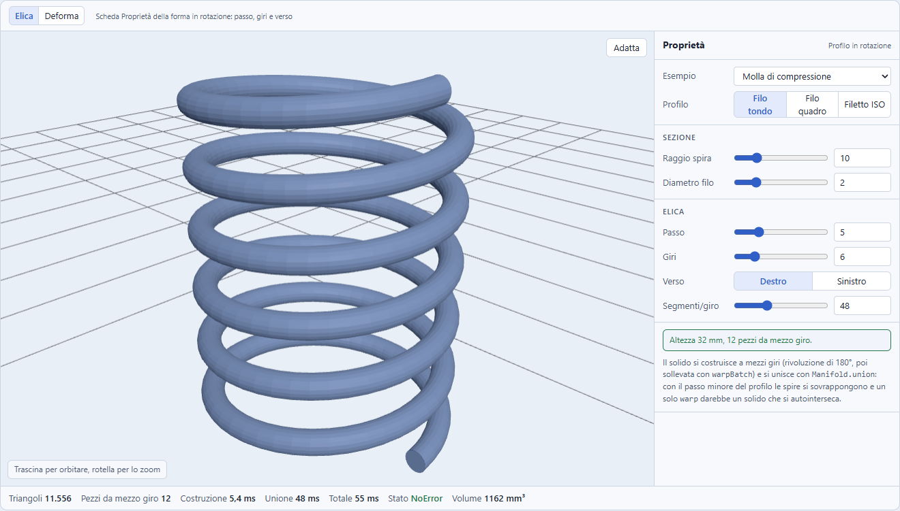

## 1. Che cosa c'è oggi

| Elemento | Stato | Riferimento |
|---|---|---|
| Torsione e Scala cima nell'estrusione lineare di una forma 2D | **Pronti**: `Manifold.extrude` con `twist` e `scaleTop`, lati del profilo spezzati in tratti lunghi uno strato | `src/kernel/evaluate.ts:454-464`, `src/kernel/twist.ts` |
| Divisioni della torsione | **Adeguate così**: una ogni 2° con tetto a 360 strati, mentre il cursore accetta ±3600°; oltre 720° ogni strato supera i 2°, ma la 0.67.0 ha misurato che il volume si conserva entro lo 0,2% anche a 3600° (Appendice A) e ha lasciato il tetto com'è | `src/scene/defaults.ts:80-82` |
| Estrusione rotazionale | **Al più 360°, senza passo**; segmenti tra 3 e 256, validi per il giro intero come `$fn` di OpenSCAD dalla 0.67.0 | `src/scene/shapes2d.ts:267`, `src/kernel/evaluate.ts:442-452` |
| Deformazioni di un solido qualunque | **Assenti**: nel kernel non si usa nessuna tra `warp`, `warpBatch`, `refineToLength`, `splitByPlane`, `simplify` | `src/kernel` |
| Gruppi con parametro e un figlio (Guscio, Ripetizione, Pattern) | **Schema pronto da seguire**: tipo di gruppo, chiave di cache, kernel, codice, strumento a pannello, campi nelle Proprietà | `src/scene/types.ts:279`, `src/kernel/evaluate.ts:92`, `:500-532`, `src/codegen/openscad.ts:517` (il ramo del Pattern è a `:537`) |
| Strumenti a pannello con anteprima | **Pronti**: `shellToolStore`, `patternToolStore` (anteprima semplificata se il kernel supera 700 ms), `ShellPanel`, `PatternFields` riusati nelle Proprietà | `src/ui/Shell`, `src/ui/Pattern`, `SLOW_PREVIEW_MS` in `patternToolStore.ts:19` |
| Formule nei campi | **Pronte** anche per percorsi nuovi, come `deform.angle`, senza altro codice | `src/scene/params.ts` (`getPath`, `setPath`) |
| Controllo dei solidi non validi | **Non basta**: legge `status()` di manifold, che per `warp` non rileva le autointersezioni | `src/scene/printability.ts:123` |
| Versione del file di progetto | `VERSION = 7` (alzata dalla 0.68.0 per il Dado; lo studio la dava a 6, una nuova forma richiede 8) | `src/scene/persistence.ts:23` |

Materiale già scritto: `docs/studio-fattibilita.md:112-142` (verificato il 17 ottobre 2026: le righe coincidono ancora) raccomanda `refineToLength` prima di `warp`, ma in forma generica. **Questo studio lo corregge**: il raffinamento isotropo è risultato da 11 a 46 volte più costoso di quello mirato con la regola predefinita (e da 42 a 164 volte rispetto al solo raffinamento assiale), sezione 4.2.

## 2. Come lo fanno gli altri

La ricerca ha usato i manuali ufficiali dove le pagine erano leggibili. Dove non lo erano, la fonte è scritta accanto all'affermazione.

| Software | Torsione | Piega | Rastremazione | Elica e filetto | Zona e interfaccia |
|---|---|---|---|---|---|
| **Blender** (manuale) | Simple Deform, Twist: angolo e asse | Simple Deform, Bend | Simple Deform, Taper: fattore | Screw: Angle, Screw (passo), Iterations, Steps, Axis | Origine (un Empty), **Limits** inferiore e superiore, Lock sugli altri assi, Vertex Group; serve una mesh suddivisa |
| **SolidWorks** Flex (Help 2023) | Twisting: angolo attorno a Z | Bending: angolo oppure raggio, lunghezza d'arco costante | Tapering: fattore | Hélice e filetto come funzioni a parte | Due **trim plane** (posizione iniziale dal riquadro), triade XYZ, cursore di accuratezza |
| **Fusion 360** | Sweep con Twist Angle | **Nessun comando** sui solidi (richieste aperte nell'IdeaStation) | Coil con Angle, oppure Loft | **Coil**: giri e altezza, giri e passo, altezza e passo, Spiral; sezione (tonda, quadra, triangolare); **Thread** ISO a tabella | Anteprima nel comando. Correzione del 17 ottobre 2026: **Insert Fastener** ha le opzioni Nut Clearance e Thread Clearance [L help.autodesk.com] e i profili di filetto per FDM di terzi sono gratuiti su GitHub (DurbansPoison/Fusion-360-FDM-threads [L]); la frase precedente, «nessun gioco di stampa (solo un add-in a pagamento)», non è sostenuta dalla ricerca sulle viti (sezione 11.2) |
| **OpenSCAD** | `linear_extrude(twist, slices)` | **Nessuno** | `linear_extrude(scale)` | `rotate_extrude(angle)`; BOSL2 `spiral_sweep`, `threaded_rod` con `$slop`; `threads-scad` con `tolerance` 0,4 | Parametri nel codice; nessun gizmo |
| **FreeCAD** | Curves, Multiloft | Nessun comando sui solidi | Cone angle dell'Helix | Part Helix e PartDesign Additive/SubtractiveHelix (pitch, height, turns, angle) | Pannello del task |
| **Onshape** | Custom feature "Deform" | idem | idem | **Helix** (Turns, Pitch, Turns and pitch); il filetto del foro è **cosmetico** («does not affect geometry», visibile in 3D dal marzo 2025 [L cad.onshape.com]); un filetto modellato richiede una custom feature (Thread Creator, Plastic Threads [A]) o elica e sweep a mano. Correzione: lo studio del 16 ottobre scriveva «filetto nativo» | Manipolatori (nella custom feature) |
| **Shapr3D** | no | no | no | Revolve oltre 360°, Sweep su spirale | nessuna |
| **Tinkercad** | non verificato | non verificato | non verificato | non verificato | nessuna |
| Slicer (Bambu, Prusa, Orca) | no | no | no | no | solo Cut con connettori |

**Livello di verifica.** Il manuale di Blender e la pagina Coil di Fusion sono stati letti direttamente. Per **SolidWorks Flex** e per le pagine del **wiki di FreeCAD** la lettura diretta è stata bloccata: i parametri vengono dal testo di anteprima dei risultati di ricerca. **Shapr3D** si basa solo su discussioni del forum, non su un manuale. L'assenza della piega in **Fusion** si basa su discussioni datate; va riverificata sull'ultima versione. Per **Tinkercad** non ho trovato fonti: nello studio dei profili la stessa lacuna è dichiarata. Un post di Hackaday sulla fine degli Shape Generators non ha data. Le correzioni su Fusion e Onshape del 17 ottobre 2026 vengono dalla ricerca sulle viti (sezione 11.2), che ha letto direttamente le pagine di aiuto di Autodesk e di Onshape. Il sorgente di `FeatureHelix.cpp` di FreeCAD è citato solo da un mirror: nelle fonti è indicato il repository ufficiale.

**Che cosa se ne ricava per Construct:**

- **I parametri come Blender** (Tipo, Asse, Angolo o Fattore, Limiti). I tre tipi stanno nello stesso strumento, come nel Simple Deform.
- **La zona come SolidWorks**: due piani di limite, mostrati nella vista, con la deformazione solo tra i due e la parte fuori zona che si muove in modo rigido.
- **La Piega con raggio o angolo, a lunghezza d'arco costante**, come Flex.
- **L'elica con due dei tre valori tra giri, passo e altezza**, come Fusion Coil e Onshape Helix; per Construct bastano giri e passo, l'altezza si calcola.
- **Il filetto** come in OpenSCAD con un gioco regolabile (`$slop` o `tolerance`): per la stampa FDM è il valore che fa funzionare il pezzo. Correzione del 17 ottobre 2026: Fusion non è privo di gioco (Thread Clearance in Insert Fastener), ma il suo filetto è modellato solo con l'opzione Modeled attiva [A] e i profili per l'FDM sono di terzi e vanno riinstallati a ogni aggiornamento [L] (deduzione: non sono pensati per la stampa); il confronto completo sulle viti è nella sezione 11.2.
- Nessuno dei programmi di fascia Tinkercad offre queste funzioni: è un vantaggio di Construct, non un obbligo.

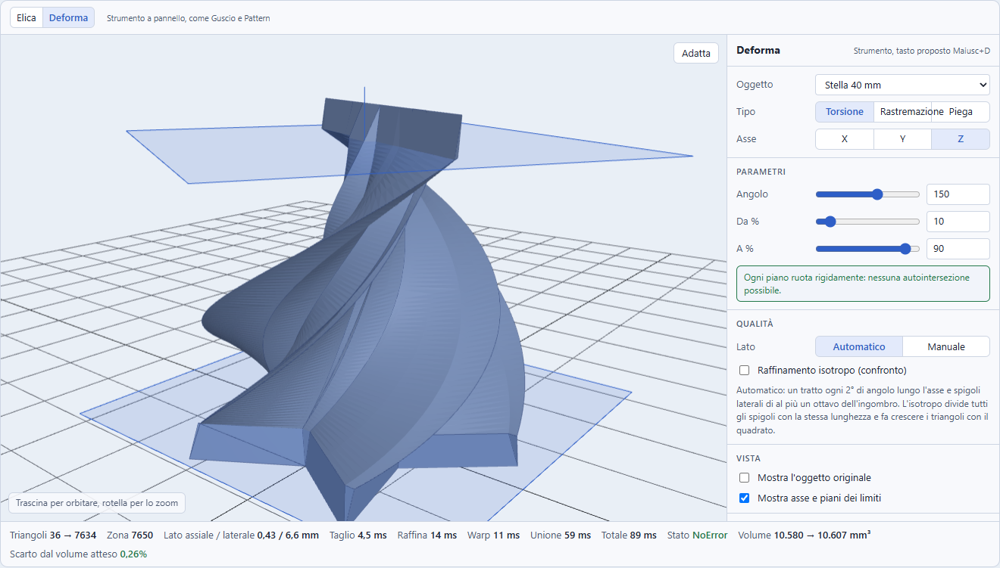

## 3. Modello dati proposto

### Elica (fase 1)

L'elica **non** può riusare `revolveParams`: l'angolo si ferma a 360° e i segmenti a 256 (20 giri a 48 segmenti sono 960), e il codice di `revolveParams` è letto da kernel, generatore, import e modale del Profilo. Si propone un campo facoltativo a parte della forma 2D in rotazione:

```ts
helix?: { pitch: number; turns: number; hand: 'right' | 'left'; segments: number }
// pitch: mm per giro (0 non ammesso); turns: giri, anche frazionari (0,5 a 60);
// segments: per giro intero. Altezza = turns * pitch + altezza del profilo (calcolata, non memorizzata)
```

Con `helix` presente, `revolveAngle` e `revolveSegments` non contano. Senza, tutto resta com'è, quindi i progetti salvati non cambiano.

### Deforma (fasi 2 e 3)

Nuovo `GroupOp` `'deform'` con un figlio, come Guscio e Pattern:

```ts
deform?: {
  kind: 'twist' | 'taper' | 'bend';
  axis: 'x' | 'y' | 'z';          // nel sistema locale del figlio
  angle: number;                   // gradi: torsione e piega (piega entro ±180)
  scale: number;                   // scala finale: rastremazione (> 0)
  dir: 0 | 1;                      // piega: quale dei due assi perpendicolari
  from: number; to: number;        // limiti in percentuale dell'ingombro lungo l'asse
  edge?: number; lat?: number;     // qualità: lato assiale e laterale in mm (assenti = automatico)
}
```

Il percorso `deform.angle` funziona già con le formule e il selettore dei parametri.

### Punti da toccare per un nuovo tipo di gruppo

- **Chiave di cache** in `evaluate.ts:92`: un op sconosciuto cade oggi nell'**intersezione** (`evaluate.ts:555`), quindi senza questo cambiare i parametri non ricalcola il gruppo.
- `src/ui/groupIcons.ts`, `store.ts:119` (`GROUP_LABELS`) e `canMoveInto` (`store.ts:205`), l'esclusione dal selettore Operazione nelle Proprietà.
- Creazione con `wrapInGroup`, come `applyPattern` in `src/scene/patternTool.ts`.
- **`VERSION` a 8.** Oggi vale 7 (`persistence.ts:23`): l'ha alzata la 0.68.0 per il Dado, e lo studio del 16 ottobre, scritto sulla 0.66.0, ne prevedeva 7 come prima alzata (la 0.66.0 la portò a 6 con la Stella). I tipi Array e Pattern non l'hanno alzata, ma una build vecchia che apre un file con `deform` mostrerebbe il figlio non deformato (intersezione di un solo solido) senza alcun avviso. Alzandola, il file viene rifiutato con un errore pulito. **L'autosalvataggio in IndexedDB ora è versionato** (correzione: lo studio del 16 ottobre scriveva il contrario, e allora era vero; la 0.67.0 ha aggiunto la chiave `construct:scene-version`, `persistence.ts:17`, scritta insieme alla scena): all'avvio una versione salvata maggiore di `VERSION` non apre il progetto, sospende il salvataggio automatico e avvisa (`persistence.ts:56-60`). Quindi alzando `VERSION` anche l'autosalvataggio viene rifiutato con un errore pulito dalle build dalla 0.67.0 in poi, e non serve un controllo a parte; le build precedenti alla 0.67.0 non conoscono la chiave e non sono protette. L'alzata a 8 è **una sola, anche se arrivano più tipi nuovi** (elica, deform, screw): vale solo se i tipi escono nello stesso rilascio, altrimenti una build intermedia con `VERSION = 8` ma senza `screw` accetterebbe un file con `screw` e il kernel fallirebbe (sezione 11.9).
- L'import da OpenSCAD ha un suo `GroupOp` ridotto (`src/import/scad/evaluate.ts:214`): `deform` non ci entra, vedi sezione 5.

## 4. Kernel

Tutto quello che segue è stato misurato nel prototipo con `manifold-3d` 3.5.4 in Node 26 su Windows, mediana di 5-7 prove. I tempi variano di 2 o 3 volte da una serie all'altra (la macchina di prova era condivisa): vanno letti come ordine di grandezza. **I triangoli sono la misura affidabile.**

### 4.1 Elica

1. Il profilo si disegna nel piano (raggio, quota), in senso antiorario.
2. Un **pezzo da mezzo giro** è `Manifold.revolve(profilo, segmenti, 180)`, poi `warpBatch` solleva ogni vertice di `passo × θ / 360`, con θ l'angolo del vertice (l'estremo a 180° può uscire come -180°: si corregge sommando 2π).
3. I pezzi si ruotano di 180° e si alzano di mezzo passo l'uno rispetto al precedente, e si uniscono con `Manifold.union`. Un pezzo basta per tutti quelli interi.
4. Il **filetto** aggiunge un nucleo cilindrico e taglia a filo le due estremità con un cilindro; il profilo è il trapezio ISO a 60° (cresta P/8, fondo P/4, altezza utile 5H/8 con H = 0,866 P) con un gioco regolabile. **Correzione del 17 ottobre 2026**: il gioco si applica come offset **normale al fianco**, non come gioco radiale (che sul fianco a 60° varrebbe solo la metà), e il profilo della vite reale usa d3 e la profondità 17H/24: vedi la sezione 11.4.

**Perché a mezzi giri e con l'unione**: `warp` non verifica le autointersezioni. Con il passo minore dell'altezza del profilo le spire si toccano o si sovrappongono: un solo `warp` darebbe un solido con triangoli che si attraversano. L'unione di manifold, invece, li fonde in un solido valido.

**Segmenti**: in `manifold-3d` 3.5.4 il numero di segmenti di `revolve` vale **per l'arco intero, qualunque sia l'angolo** (misurato: 48 segmenti su 360°, 180°, 90° e 45° danno sempre 48 divisioni). Nel prototipo si scalano per l'angolo del pezzo, così `segments` vale per giro intero. **Dalla 0.67.0 il kernel fa lo stesso** (`evaluate.ts:448-450`: `ceil(segments * angolo / 360)`, con un minimo di 3), quindi il pezzo da mezzo giro dell'elica e la rotazione esistente seguono la stessa regola e quella di `rotate_extrude(angle, $fn)` di OpenSCAD. Vedi anche l'appendice A.

| Caso | Triangoli | Tempo | Volume (atteso con Pappus) | Componenti, genere |
|---|---|---|---|---|
| Molla, raggio 10, filo 2, passo 5, 6 giri, 48 seg/giro | 11 556 | circa 25-65 ms | 1 162 mm³ (1 165) | 1, 0 |
| Molla a 20 giri | 38 436 | circa 80-130 ms | 3 873 mm³ | 1, 0 |
| Spire che si toccano (passo 2, filo 3) | 8 108 | circa 50-120 ms | 1 445 mm³ | 1, **1** (un guscio cilindrico fuso, quindi genere 1 è corretto) |
| Filo quadro 2,5 × 2, passo 4, 5 giri | 1 924 | circa 5-8 ms | 1 882 mm³ (1 885) | 1, 0 |
| Filetto M8 passo 1,25, 8 giri | 8 600 | circa 60-125 ms | 380 mm³ | 1, 0 |
| Filetto M8, 20 giri | 20 888 | circa 130-290 ms | 949 mm³ | 1, 0 |
| Filetto M5 sinistro, 10 giri | 6 076 | circa 60-90 ms | 117 mm³ | 1, 0 |

**Nota del 17 ottobre.** I casi con profilo ISO (filetti) di questa tabella usano il profilo ISO di base (profondità 5H/8) con gioco solo radiale `size/2 − gap`, cioè la scheda Elica del 16 ottobre. Il profilo della vite con fondo a d3 e l'offset normale per il foro, descritti in 11.4, non sono misurati nella scheda Elica ma nella scheda Viti (11.5).

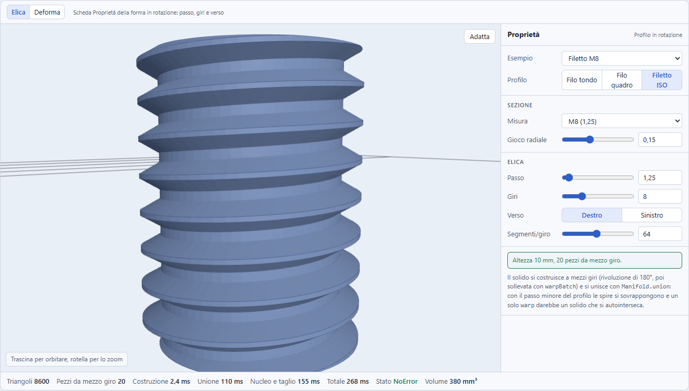

### 4.2 Deforma: la pipeline misurata

Un `warp` sposta solo i vertici esistenti: su un cubo da 12 triangoli non produce curve. Serve quindi prima suddividere, e il **modo** in cui si suddivide decide il costo. La pipeline che il prototipo ha validato è questa:

1. **Controlli analitici** (sezione 4.3): se non passano, errore del gruppo, come "pareti troppo spesse" del Guscio.
2. **Taglio sui limiti** con `splitByPlane` sul piano `da` e sul piano `a`: la parte fuori zona resta con i triangoli di partenza e i limiti sono esatti (con un solo `refine` il limite cadrebbe sul vertice più vicino).
3. **Raffinamento a due lunghezze della sola zona**: lato `edge` lungo l'asse e lato `lat` nel piano della sezione. Si ottiene dilatando l'asse di `lam = ceil(lat / edge)` volte, con `refineToLength(edge · lam)` e poi la scala inversa: gli spigoli assiali si dividono in tratti da `edge`, quelli laterali solo se superano `lat`.
4. **`warpBatch`** della zona e della parte oltre il limite: lì la funzione è già un moto rigido (rotazione, scala costante, rotazione con traslazione), quindi non serve raffinare.
5. **`Manifold.union`** delle (fino a) tre parti: le facce coplanari sui piani di taglio si fondono.

I `delete()` di ogni passaggio intermedio sono parte della pipeline, non un'ottimizzazione (sezione 4.4).

**Perché il raffinamento è mirato.** Sotto Torsione, Piega e Rastremazione ogni piano perpendicolare all'asse si trasforma in un piano (o resta tale con una rotazione rigida, una scala o una rotazione di raggio dipendente dalla posizione): **gli spigoli che stanno in quel piano restano rettilinei**. Dividere anche quelli è sprecato; basta dividere quelli lungo l'asse. Misurato su un cubo da 30 mm con torsione:

| Torsione | Solo assiale (2°, senza taglio laterale) | Isotropo (`refineToLength` semplice) | Rapporto |
|---|---|---|---|
| 90° | 732 triangoli | 30 480 | 42 |
| 180° | 1 452 | 119 688 | 82 |
| 360° | 2 892 | 473 940 | 164 |

Con la regola predefinita proposta (spigoli laterali al più un ottavo dell'ingombro) il cubo a 360° passa a 10 296 triangoli: è un costo di 3,5 volte per una precisione che sul cubo non serve, ma che serve negli altri casi (4.2.1).

#### 4.2.1 Qualità della Torsione: due lunghezze, non una

Il solo raffinamento assiale lascia lunghi gli spigoli del piano: ogni quadrilatero di parete tra due strati è storto, e la diagonale che lo divide si scosta dalla superficie vera. Il volume di un cubo non se ne accorge (-0,01%), ma quello di una piastra con fori e di una stella sì. Misurato **rispetto al volume esatto** (la torsione lo conserva), a 2° per tratto:

| Oggetto e angolo | Solo assiale | Con spigoli laterali ≤ 10 mm | Isotropo |
|---|---|---|---|
| Scatola con tre fori, 120° | +0,44% con 24 408 triangoli | -0,08% con 27 524 | -0,02% con 600 072 |
| Stella a cinque punte, 360° | -0,36% con 7 236 | +0,13% con 10 168 | -0,02% con 222 512 |

Lo scarto del solo raffinamento assiale scende **in modo lineare** con il passo (scatola: 0,87%, 0,44%, 0,22%, 0,11% a 4°, 2°, 1° e 0,5° per tratto), cioè dimezzare il passo raddoppia i triangoli per dimezzare l'errore. Tagliare gli spigoli laterali rende lo stesso risultato con il 13% di triangoli in più sulla scatola (sulla stella il 40%, da 7 236 a 10 168). **Il volume è una misura debole** (errori di segno opposto si compensano) e non ho misurato la distanza dalla superficie vera: va aggiunto ai test della fase 2 (distanza massima da una superficie di riferimento calcolata a passo molto fine).

La qualità automatica della Torsione quindi è: **un tratto assiale ogni 2° di angolo** e **spigoli laterali non più lunghi di un ottavo dell'ingombro nel piano**. Piega e Rastremazione non hanno il problema (le facce restano esatte, tranne le corde): lì i lati laterali non si dividono.

### 4.3 Controlli analitici e autointersezioni

`status()` di manifold non rileva le autointersezioni prodotte da `warp`, e l'avviso `invalid` di `printability.ts:123` si appoggia a quello. Per questo i controlli stanno nel kernel, prima del calcolo, e sono analitici. Ogni deformazione agisce su un piano alla volta, quindi:

- **Torsione**: ogni piano ruota rigidamente. La mappa è iniettiva per qualsiasi angolo: **nessuna autointersezione possibile**. Il determinante è 1, quindi il volume si conserva.
- **Rastremazione**: scala positiva piano per piano: nessuna autointersezione se `scale > 0`. Il controllo rifiuta 0 e valori negativi. Il volume è `(V/L) · ∫ s(t)² dt` per un solido a sezione costante lungo l'asse (nel prototipo l'atteso si calcola solo in quel caso).
- **Piega**: i piani diventano spicchi che si aprono dal centro di curvatura. La mappa è iniettiva se il **raggio `R = lunghezza della zona / angolo` supera la distanza massima del solido dal piano neutro, sul lato interno**, e se le due code non si incrociano. Fino a **±180°** le code sono antiparallele e distano `2R`, che supera lo spessore, quindi basta il controllo del raggio. **Oltre i 180° il controllo non basta**: l'angolo va limitato a ±180° oppure va aggiunto un controllo sulle code. Questo studio propone ±180°.

Provato nel prototipo: una barra 100 × 10 × 5 si piega fino a 180° (raggio 31,8 mm, lato interno 5 mm); un cubo da 30 mm con 180° è rifiutato con "Raggio 9,5 mm, minore dello spessore dal lato interno (15,0 mm)". Il volume della barra piegata torna entro lo 0,02%.

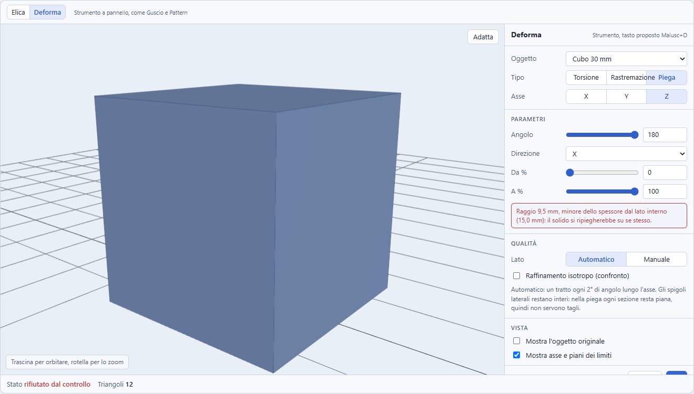

### 4.4 Costi, memoria e tetto di triangoli

| Caso | Triangoli | Tempo | Scarto di volume |
|---|---|---|---|
| Cubo 30 mm, torsione 90° | 2 696 | 6 ms | +0,01% |
| Cubo 30 mm, torsione 360° | 10 296 | 16 ms | -0,01% |
| Cubo 30 mm, torsione 3600° | 101 016 | 194 ms | -0,02% |
| Stella, torsione 360° | 12 382 | 15 ms | +0,17% |
| Scatola con fori, torsione 120° | 27 604 | 43 ms | -0,08% |
| Scatola con fori, torsione 120° con limiti 25-75% | 27 822 | 174 ms (l'unione di tre parti pesa) | -0,01% |
| Scatola con fori, torsione 720° | 159 620 | 370 ms, 203 MB di memoria del processo | -0,11% |
| Scatola con fori, torsione 3600° | **792 940** | **1,8 s, 711 MB** | -0,17% |
| Cubo, rastremazione 40% | 140 | 0,3 ms | 0,00% |
| Scatola con fori, rastremazione 40% | 3 608 | 6 ms | 0,00% |
| Barra 100 × 10 × 5, piega 90° | 732 | 1,6 ms | -0,02% |
| Barra, piega 180° | 1 444 | 2,7 ms | -0,02% |
| Scatola con fori, piega 60° attorno a X | 3 504 | 7,5 ms | -0,02% |

Tutti: una componente, genere 0 o 3 (la scatola ha tre fori passanti), stato `NoError`. La memoria è quella residente del processo di prova, che dopo il picco non scende più.

- **Il tetto di triangoli è un requisito, ma solo per il nuovo gruppo Deforma.** La torsione a 3600° su una piastra con fori, con la pipeline di Deforma (raffinamento assiale più laterale di una mesh già costruita), produce quasi 800 mila triangoli, circa 2 secondi, e 711 MB di memoria WASM che non si restringe più dopo il calcolo. L'anteprima semplificata dei Pattern (oltre 700 ms) è lo schema giusto da riusare. Si propone un **budget di triangoli** per Deforma: il passo assiale cresce oltre i 2° solo quando il costo stimato supera il budget (i triangoli crescono con angolo × ingombro nel piano / lato laterale), e il pannello mostra la qualità effettiva, come fa il Profilo con i tetti dei punti.
- **La torsione lineare che esiste già non cambia.** Lo studio del 16 ottobre proponeva di sostituire con un budget anche il tetto di 360 strati di `twistDivisions` (`defaults.ts:80-82`), perché a ±3600° dà 10° per strato. Quella proposta è **superata**: la 0.67.0 ha misurato su un profilo 60 × 5 × 40 mm (volume esatto 12 000 mm³) un errore di -0,19% a 3600°, +0,03% a 1800°, e ha deciso di non cambiare il tetto (portare gli strati a 1800 darebbe +0,05% con quattro volte i triangoli). Un test lo fissa sotto l'1% (`src/kernel/evaluate.test.ts:260`) e la misura sta in `docs/da-fare.md:104`. In più `subdivideContours` ha già il suo limite di vertici (`MAX_SOLID_POINTS` in `src/kernel/twist.ts:14`). La pipeline di Deforma è un'altra (`deform.ts`, sezione 4.2) e non passa da `subdivideContours`: per questo il budget resta richiesto lì e non per `Manifold.extrude` con `twist`.
- **La memoria WASM non la libera il garbage collector in tempo.** Nella prima serie di misure un ciclo senza `delete()` degli intermedi ha portato il puntatore oltre i 2 GB e `warpBatch` è caduto con `RangeError: Start offset -1890640352 is outside the bounds of the buffer`. Il kernel dell'app libera già gli intermedi a mano (`evaluate.ts`); lo stesso vale per `deform.ts` e `helix.ts`. Nel prototipo, `scope()` raccoglie i temporanei e li cancella a fine calcolo.
- **Il `splitByPlane` aggiunge un'unione**: con i limiti interni il tempo cresce (174 ms contro 43 nella scatola). Con i limiti a 0 e 100 la pipeline salta il taglio e l'unione.

### 4.5 Ordine rispetto alle booleane

Si decide con l'annidamento dei gruppi, non con un'opzione: **Deforma dopo la differenza** deforma anche i fori (di solito è quello che si vuole: una piastra forata e poi torta), **Deforma prima** lascia i tagli dritti. Il gruppo Deforma accetta un solo figlio, qualunque nodo (primitiva, forma 2D, mesh, un altro gruppo). Le mesh importate funzionano purché siano manifold.

## 5. Codice OpenSCAD e ritorno dall'import

OpenSCAD non ha deformazioni generiche. Il codice esportato deve restare **coerente con il kernel** (regola del progetto), con un avviso dove non è possibile.

| Oggetto | Codice esportato | Coerenza |
|---|---|---|
| Elica | Un modulo `construct_helix(...)` scritto una volta in testa al file, come fa BOSL2 con `spiral_sweep`: costruisce un `polyhedron` per ogni mezzo giro dentro `union()`. Passo, giri e verso restano parametri leggibili e funzionano con il Customizer. | Stessi punti del profilo e stessa regola dei segmenti del kernel. Con il backend Manifold di OpenSCAD l'unione è veloce; con CGAL è lenta (avviso nel commento). |
| Torsione o Rastremazione di una forma 2D estrusa lungo il proprio asse Z, asse coincidente | `linear_extrude(height, twist = -angolo, scale = ...)`: nativo, leggibile, già usato oggi per la torsione | Entro la tolleranza. **Il segno cambia**: la torsione di OpenSCAD è oraria, quella di Construct antioraria (`openscad.ts:175` già scrive `twist = -p.twist`). |
| Qualunque altro caso, Piega compresa | Il figlio **non deformato**, con il commento `// ATTENZIONE: la deformazione Piega non si può rappresentare in OpenSCAD: usa l'export STL o 3MF` | Il codice non coincide con il solido: l'avviso è ben visibile anche nella finestra del codice. |

**Ritorno dall'import.** `src/import/scad/` non legge `polyhedron` (nodo mancante, vedi `da-fare.md`). Quindi il modulo dell'elica ha bisogno di un **commento di servizio** riconosciuto dall'import, come `// construct:path` per i profili di Bézier (scritto in `openscad.ts:199`, letto da `parse.ts:104` e validato da `restorePath` in `pathMeta.ts:28`): `// construct:helix {...}` con profilo, passo, giri, verso e segmenti, e la chiamata `construct_helix(...)` che l'import riconosce e ricostruisce come forma in rotazione con `helix`. Senza il ritorno un'elica esportata e riletta sparisce. Per `deform` non serve un ritorno (non si esporta in modo non nativo); i casi nativi tornano come `linear_extrude` con torsione, già letta.

**Verifica ancora da fare.** OpenSCAD non è installato in questa macchina, quindi la coincidenza del volume dell'elica esportata con quella del kernel **non è stata provata**: è il primo test della fase 1. La regola dei frammenti è invece confermata nel sorgente (appendice A).

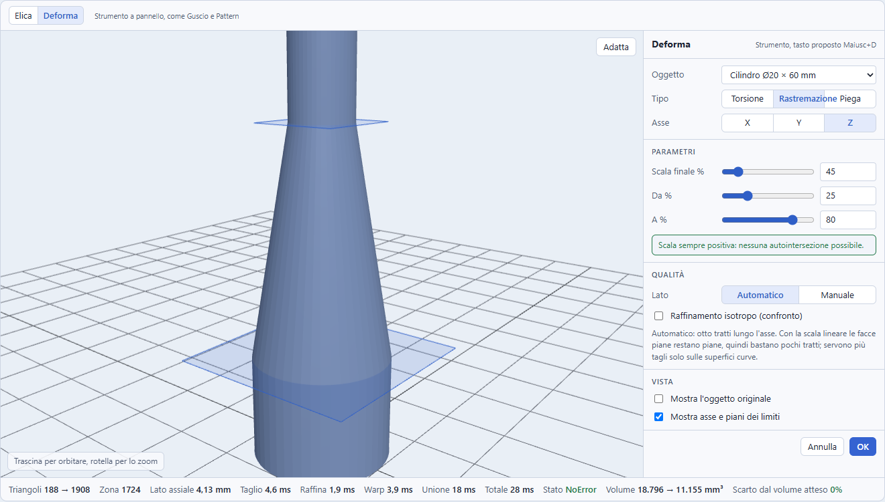

## 6. Interfaccia

Il prototipo ha tre schede; qui si descrivono le prime due, perché le due funzioni stanno in posti diversi di Construct (la scheda Viti è descritta in 11.7).

### Elica: Proprietà della forma in rotazione

Non è uno strumento: è una sezione delle Proprietà di una forma 2D (o di un Profilo) con estrusione rotazionale, accanto ad Angolo e Segmenti.

```
Rotazione
Passo        [ 5 ] mm          (vuoto = rotazione normale)
Giri         [ 6 ]
Verso        ( Destro | Sinistro )
Segmenti/giro [ 48 ]
Altezza 32 mm (calcolata)
! Passo minore del profilo: le spire si toccano e si fondono.
```

L'avviso è informativo, non un errore: una molla chiusa a spire fuse è un solido valido (genere 1).

### Deforma: strumento a pannello

Tasto proposto **Maiusc+D**: tutte le 26 lettere senza modificatori sono occupate (riverificato il 17 ottobre 2026 con grep in `useShortcuts.ts`) e Maiusc+D non è assegnata. Oggi però fa la stessa cosa di D (cambia il tema, `useShortcuts.ts:109`, perché la lettera semplice non esclude Maiusc): il nuovo controllo va **prima** di quella riga, come già fanno Maiusc+H (`:114`), Maiusc+P (`:121`), Maiusc+V (`:129`) e Maiusc+S (`:143`). Pannello flottante come Guscio e Pattern:

```
Deforma                                    [x]
Tipo   ( Torsione | Rastremazione | Piega )
Asse   ( X | Y | Z )
Angolo [ 120 ] °        (Piega: Direzione [ Y ])
Da [ 0 ] %   A [ 100 ] %
Qualità  ( Automatico | Manuale )
[x] Mostra asse e piani dei limiti
Raggio 31,8 mm, spessore interno 5 mm: nessuna autointersezione.
                                   [Annulla] [OK]
```

- **In vista**: l'asse neutro (deformato, quindi curvo nella Piega) e i due piani dei limiti, calcolati con la stessa funzione di warp: la torsione li ruota, la rastremazione li rimpicciolisce, la piega li inclina. Il prototipo li mostra e funzionano. Nella **fase 3** i piani si trascinano.
- **Anteprima**: semplificata (passo maggiore) quando il kernel supera 700 ms, come per il Pattern; la qualità piena si calcola all'OK. Un solo passo di Annulla (`labelled('Deforma', ...)`).
- **Le stesse righe** nelle Proprietà del gruppo (`DeformFields`, come `PatternFields`), con le formule.
- **Altri file da toccare**: registro dei comandi in `commands.tsx` (identificativo, contesto, voce in `COMMANDS` e in `TOOL_COMMANDS`), `useShortcuts.ts` per Esc, Invio e il tasto, `toolbarHelp.ts` con immagine, `Viewport.tsx`, e **tutti gli altri `toggle` che si annullano a vicenda** (ogni strumento chiude gli altri a mano).
- Il prototipo misura anche l'interfaccia stretta: a 390 px non scorre in orizzontale; i controlli sono accessibili da tastiera (`aria-pressed` sui selettori, `aria-label` sui numeri).

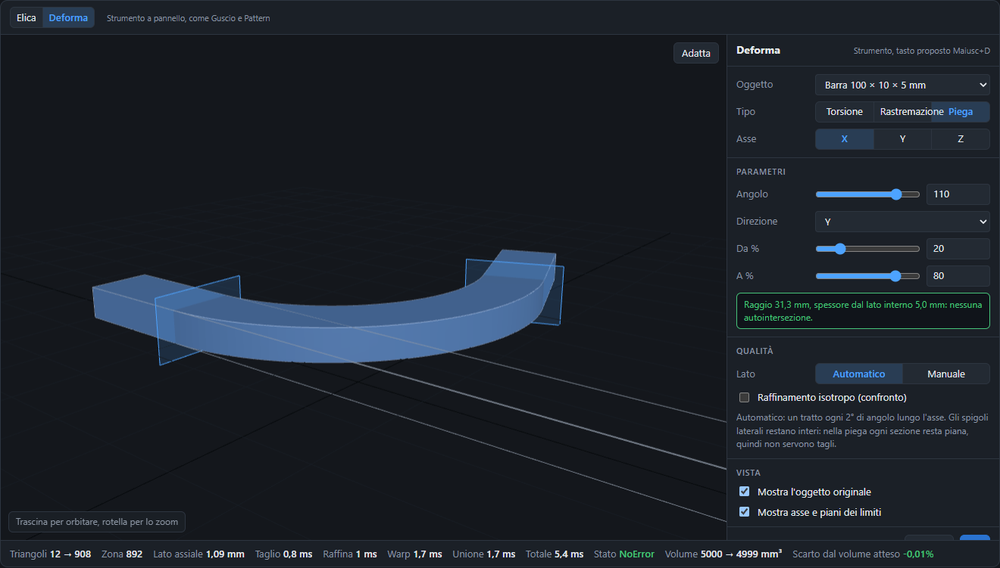

## 7. Miglioramenti proposti

- **Ritirata** la proposta del 16 ottobre di sostituire il tetto di `twistDivisions` con un budget di triangoli: la 0.67.0 ha misurato che il tetto conserva il volume entro lo 0,2% anche a 3600° e non l'ha cambiato (sezione 4.4). Il budget di triangoli serve solo al nuovo gruppo Deforma.
- **Distanza dalla superficie vera** nei test, accanto al volume (sezione 4.2.1).
- Opzione **simmetrica** per la rotazione, come Fusion (da -angolo/2 a +angolo/2), già in `da-fare.md`.
- **Deforma più volte**: si annida come il Pattern (un gruppo dentro l'altro).
- **Molla** come preset dell'elica nella libreria (fase 1); **viti, dadi e fori filettati** come primitiva `screw` (sezione 11, fase 4).
- Avviso di stampabilità per **spire sotto l'ugello** e per i filetti con gioco insufficiente.
- **Piega con asse scelto con un clic** su una faccia (come "Appoggia su una faccia").

## 8. Rischi e limiti

| Rischio | Gravità | Mitigazione |
|---|---|---|
| Autointersezione della Piega oltre i 180°, o con raggio piccolo | Alta | Controllo analitico del raggio e angolo limitato a ±180° (sezione 4.3); errore del gruppo con il perché |
| Crescita dei triangoli e della memoria nel gruppo Deforma (800 mila triangoli, 711 MB nel caso estremo) | Alta | Budget di triangoli per Deforma, raffinamento mirato, anteprima semplificata, `delete()` degli intermedi |
| `status()` non rileva le autointersezioni di `warp` | Media | Controlli prima del calcolo; test con volume e distanza dalla superficie |
| Torsione con spigoli laterali lunghi: scarto di volume fino allo 0,4% | Media | Regola dei due lati (sezione 4.2.1) |
| Coerenza kernel e codice: `revolve` segmenti per arco (appendice A) | Chiuso | Risolto nella 0.67.0 (segmenti per giro intero nel kernel, come `rotate_extrude`); l'elica segue la stessa regola |
| Codice OpenSCAD che non coincide con il solido (Piega) | Media | Avviso nel commento e nella finestra del codice; export STL e 3MF corretti |
| Ritorno dall'import dell'elica | Media | Commento di servizio e test di andata e ritorno |
| `VERSION` non alzata: una build vecchia mostra il figlio non deformato | Media | `VERSION = 8` (oggi 7), una sola alzata per elica, Deforma e `screw` se escono insieme (sezioni 3 e 11.9) |
| Mesh importate non manifold | Bassa | Il gruppo segue lo stato già mostrato per le mesh |
| Verso delle facce dopo il warp | Bassa | Il determinante positivo dei tre warp lo mantiene: verificato dal volume positivo |
| Tempo di unione dei pezzi dell'elica con molti giri | Bassa | 20 giri sono circa 130-290 ms; si può costruire a pezzi più lunghi |

## 9. Fasi e stima

Un branch e una PR per fase, con il metodo già in uso (un agente implementa, un agente nuovo revisiona).

**Interventi preliminari:** nessuno. Le due proposte del 16 ottobre sono chiuse dalla 0.67.0: il tetto di `twistDivisions` resta com'è (misurato, sezione 4.4) e i segmenti di `revolve` sono già allineati a OpenSCAD (appendice A).

| Fase | Contenuto | Test | Costo relativo |
|---|---|---|---|
| **1. Elica** (con la molla) | Campo `helix` della forma in rotazione, `src/kernel/helix.ts` (mezzi giri, `warpBatch`, `union`), sezione nelle Proprietà, modulo OpenSCAD con ritorno dall'import; la **molla** (diametro, filo, passo, giri, estremità piane) è un preset dell'elica | Volume e ingombro contro Pappus, genere, mano destra e sinistra, passo minore del profilo, andata e ritorno OpenSCAD, confronto del volume con OpenSCAD in locale, benchmark | Medio |
| **2. Torsione e Rastremazione** | Gruppo `deform` (`twist`, `taper`), `src/kernel/deform.ts` con la pipeline della sezione 4.2, strumento a pannello con tasto Maiusc+D, piani dei limiti in vista, codice nativo `linear_extrude`, `VERSION = 8`, budget di triangoli (solo per Deforma) e anteprima semplificata | Volume, ingombro, limiti esatti, componenti e genere, distanza dalla superficie, codice, e2e del pannello, benchmark | Alto |
| **3. Piega** | Tipo `bend`, controllo del raggio e angolo ±180°, scelta Angolo o Raggio, piani dei limiti trascinabili | Come la fase 2, più raggio minimo e i casi rifiutati | Medio |
| **4. Viti e fori filettati** (sostituisce «Filetto e Molla»; facoltativa) | **4a** filetto e gambo, foro filettato; **4b** teste e impronte; **4c** madrevite e sede del dado. Primitiva `screw` (sezione 11), `src/scene/fasteners.ts` e `src/scene/drives.ts`, `VERSION = 8` se non già alzata | Misure ISO (Appendice B), gioco, ingombro, andata e ritorno OpenSCAD, e2e della libreria | Alto in tutto, medio per ogni sotto-fase |

La fase 1 si può fare da sola e dà subito valore (molle e filetti). Le fasi 2 e 3 condividono il gruppo e la pipeline. La fase 4 dipende dall'elica (fase 1) per il filetto; la forma è decisa (un nodo parametrico, sezione 11.3) e la molla non ne fa più parte, perché resta un preset dell'elica.

Alternativa per i soli **filetti** (fase 4a): OpenSCAD li fa anche con `linear_extrude(twist)` di una sezione perpendicolare all'asse, nativo e leggibile; non vale per le molle a filo tondo. Per l'impronta e per il resto della vite serve comunque il modulo `construct_screw` (sezione 11.6).

## 10. Domande aperte

- **Filetto e Molla, preset o nodo** (domanda **chiusa il 17 ottobre 2026**): nodo parametrico `kind: 'screw'` (sezione 11.3). Con il preset la misura M8 non si potrebbe più cambiare dopo la creazione; con il nodo sì, al prezzo di un tipo nuovo e di un ritorno dall'import (sezione 11.6). La molla resta un preset dell'elica.
- **Mano dell'elica**: campo esplicito (`hand`, proposta) oppure passo negativo?
- **Origine della deformazione**: il centro dell'ingombro del figlio (usato nel prototipo) o l'origine del suo sistema locale?
- **Rastremazione**: scala uniforme (come nel prototipo) o per asse, con Lock come in Blender?
- **Stretch** (Blender e SolidWorks): escluso, perché duplica il Ridimensiona.
- **Budget di triangoli** del gruppo Deforma: valore iniziale (il prototipo rifiuta oltre 800 mila nel raffinamento isotropo di confronto).
- Le domande aperte sulle viti sono nella sezione 11.9.

## 11. Viti, dadi e fori filettati ISO

Data: 17 ottobre 2026, sulla versione 0.68.0. Domanda: si possono aggiungere a Construct **viti**, **dadi** e **fori filettati** metrici ISO, con filetto modellato e adatto alla stampa FDM, modificabili dopo la creazione, coerenti con il kernel, con il codice OpenSCAD esportabile e con l'interfaccia, e in quali fasi? Questa sezione estende lo studio dell'elica (la tecnica del filetto è quella della sezione 4.1) e **chiude la domanda aperta «preset o nodo»** della sezione 10 a favore del nodo.

**Esito: fattibilità alta** per viti e fori con il filetto modellato (M3-M12, passo grosso): una nuova primitiva parametrica `kind: 'screw'` ("Vite"), la cui variante foro è `tapped` (nasce con `mode: 'hole'`) con filetto interno e gioco, non richiede librerie nuove. **Media** per le impronte a croce Phillips e Torx fedeli alla norma, perché le tabelle trovate sono incomplete (PH4 e T45, T50, T55 non sono tabellati) e vanno completate con una fonte letta. Le misure del prototipo, che fanno parte dell'esito, sono nella sezione 11.5.

**Come sono state raccolte le misure ISO.** Le norme ISO non sono gratuite e **non sono state lette direttamente**: ogni tabella viene da cataloghi che le riproducono (fasteners.eu, fasten.it, Wikipedia, Optimas, Engineering Toolbox, AmesWeb, BOSL2). Il livello di verifica è scritto accanto a ogni dato: **[L]** pagina letta direttamente, **[A]** solo anteprima di ricerca, **[C]** calcolato da una formula, **[M]** valore a memoria non verificato. Le tabelle complete sono nell'Appendice B.

**Dado, madrevite e il nome in libreria.** In italiano «dado» indica sia il dado esagonale a vite sia il dado da gioco, e dalla 0.68.0 «Dado» è in Construct il solido a facce (8, 10, 12, 20 o 30 facce, `PRIMITIVE_LABELS` in `src/scene/defaults.ts:13`). Il dado a vite si chiama quindi **Madrevite** («madrevite» è il nome tecnico italiano della filettatura interna e, per estensione, del dado a vite: uso a memoria, non verificato su una norma UNI). Le etichette in libreria non devono essere l'una l'inizio dell'altra, perché i test e2e cercano i pulsanti con `title^="Aggiungi: <etichetta>"` (`e2e/app.spec.ts:495`, e il commento a `src/scene/defaults.ts:37`): le tre voci sono **Vite**, **Foro filettato** e **Madrevite**, nessuna prefisso di un'altra e nessuna prefisso di «Dado».

### 11.1 Che cosa c'è oggi

I riferimenti `file:riga` di tutto lo studio valgono sul tag **v0.68.0**: la 0.69.0 (fase 3 dei Profili) fa slittare di poche righe alcune posizioni in `store.ts` (di 7 righe da `GROUP_LABELS` in poi, fino a 28 per `toggleHoleSelected`) e in `PropertiesPanel.tsx` (di 1 o 9 righe), e in `commands.tsx` di una riga.

| Elemento | Stato | Riferimento verificato (17 ottobre 2026, sul tag v0.68.0) |
|---|---|---|
| Primitive | Sei tipi: cubo, cilindro, cono, sfera, toro, dado; **nessuna è meccanica** | `PrimitiveKind` in `src/scene/types.ts:66`, `PrimitiveNode` `:68` |
| Misure normalizzate | **Nessuna tabella ISO nel repo** (nessun file di `src` nomina una norma ISO); i profilati a L, T, H, U e i tubolari sono solo parametrici | `clampProfile` in `src/scene/profiles.ts:98`, `profileContours` `:256` |
| Filetto ed elica | **Assenti**: lo studio dell'elica (sezione 4.1) non è ancora implementato | `revolveParams` in `src/scene/shapes2d.ts:267`, `src/kernel/evaluate.ts:442-452` |
| Foro | **Pronto**: `NodeMode = 'solid' \| 'hole'`, tasto H, selettore Solido/Foro nelle Proprietà, operandi fantasma; un foro **alla radice non sottrae nulla** (si mostra traslucido) e nemmeno dentro un Raggruppa: sottrae solo dentro Unione, Differenza e Intersezione. I connettori di Dividi creano già primitive con `mode: 'hole'` | `src/scene/types.ts:6`, `toggleHoleSelected` in `src/scene/store.ts:618`, `src/hooks/useShortcuts.ts:115`, `src/ui/PropertiesPanel/PropertiesPanel.tsx:131-147`, `ghosts` in `src/kernel/evaluate.ts:647`, `unionOfSolids` `:687`, `connectorPrimitive` in `src/scene/splitTool.ts:151` |
| La modalità non cambia la geometria | La chiave di cache di un nodo **esclude** `mode`: cambiare Solido/Foro non ricalcola, quindi nessun parametro può dipendere dal modo (conseguenza in 11.3) | `src/kernel/evaluate.ts:95` e `:99` |
| Primitiva nel kernel | `primitive()` costruisce ogni primitiva centrata nell'origine; il toro è `CrossSection.circle(...).translate(...).revolve(...)` (modello per le teste a corpo di rivoluzione); lo `switch` non ha un ramo `default` | `src/kernel/evaluate.ts:158-197` (toro a `:188-193`) |
| Codice OpenSCAD | `primitiveLines` per kind; l'intestazione del file (`// Generato da Construct`, i `use <font>`, il blocco Parametri) è il punto dove scrivere un `module construct_screw(...)` una sola volta; i fori escono dentro `difference()`, quelli alla radice non escono | `src/codegen/openscad.ts:77`, intestazione `:580`, `solidsOf` `:586`, `groupLines` `:517` |
| Import OpenSCAD | **Esegue i moduli dell'utente** (`callModule` cerca prima il modulo definito nel file e solo dopo i comandi predefiniti); **non legge `polyhedron`** (nodo mancante, saltato con avviso); precedenti: il piatto `piatto_N` riconosciuto per nome prima dell'esecuzione e il commento `// construct:path` validato ricalcolando | `callModule` in `src/import/scad/evaluate.ts:1109`, `polyhedron` `:1055`, `plateCall` `:1137`, `src/import/scad/parse.ts:104`, `restorePath` in `src/import/scad/pathMeta.ts:28`, `src/import/scad/toScene.ts:215` |
| Libreria | `SHAPES_3D` è una griglia piatta (non esiste una categoria Meccanica; `AccordionGroup` è usato solo in Simboli ed Emoji); le etichette e il test dell'ordine esatto delle Forme 3D (con «Dado» in fondo) sono fissati dagli e2e | `SHAPES_3D` in `src/scene/defaults.ts:64`, `Shapes3DGrid` in `src/ui/ShapeLibrary/ShapeLibrary.tsx:46`, `src/ui/ShapeLibrary/CharacterGroups.tsx:106-117`, `e2e/app.spec.ts:1637-1643` |
| Misure ricordate | `lastValues.ts` ricorda le ultime misure per `kind` e **scarta in silenzio** i campi stringa non previsti da `isValid` | `SHAPE_FIELDS` in `src/scene/lastValues.ts:19`, `isValid` `:58` |
| Formato del progetto | `VERSION = 7` (alzata dalla 0.68.0); una nuova primitiva richiede 8 | `src/scene/persistence.ts:23` |
| Formule nei campi | `getPath` e `setPath` funzionano su qualunque campo numerico, quindi `length` e `gap` si possono legare a un parametro senza altro codice | `src/scene/params.ts:188`, `:194` |

### 11.2 Come lo fanno gli altri

Il livello di verifica sta accanto a ogni affermazione. **La ricerca ha letto pagine di aiuto, documentazione e sorgenti; non risultano prove di esecuzione dei programmi**, quindi nessun confronto numerico con i loro risultati (per esempio il volume di una M6 di BOSL2 contro la nostra) è stato fatto: è una lacuna dichiarata.

| Software | Viti e dadi | Fori e filetto | Gioco e stampa | Verifica |
|---|---|---|---|---|
| **Fusion 360** | **Insert Fastener**: libreria di viteria (Bolts and Screws, Nuts, Washers, Rivets) con filtri per standard (ANSI, DIN, ISO), tipo di testa, filetto e misura; le misure della testa sono di sola lettura; **il tipo di impronta non è tra i filtri**. I file McMaster-Carr sono STEP statici, non parametrici | Comando **Hole** (Simple, Counterbore, Countersink; maschiatura Simple, Clearance, Tapped con tipo di filetto, misura, classe e casella **Modeled**; Taper Tapped) e comando **Thread** (Modeled o cosmetico, Full Length oppure Offset e Length, Designation, Class, Direction destro o sinistro) | Insert Fastener ha **Nut Clearance** e **Thread Clearance**. I profili di filetto per FDM sono di terzi, gratuiti su GitHub: trapezoidali con angoli da 50° a 90°, creste e radici piatte larghe un quarto del passo, classi che codificano il gioco, perse a ogni aggiornamento. Il filetto è geometria solo con Modeled attivo | pagine di aiuto **[L]**; file McMaster **[A]**; add-in «Bolt Generator» della community (esagono incassato, bombata, svasata) **[A]**; Modeled **[A]**; profili FDM **[L GitHub DurbansPoison]** |
| **SolidWorks** | **Toolbox** con tre visualizzazioni (Simplified, Cosmetic, Schematic) | **Hole Wizard** (Counterbore, Countersink, Hole, Straight Tap, Tapered Tap, asole; preferiti), accoppiamento Close, Normal, Loose; filetto **cosmetico** (annotazione, non geometria; foro al diametro della punta) | non trovato | **[A]**, pagine non leggibili; **non trovate fonti su come si sceglie la testa ISO o DIN** |
| **FreeCAD** | **Fasteners Workbench**: moltissimi standard ISO e DIN (viti ISO 4014, 4017, 4762, 7380, 10642, 14579, 14580, 14583, DIN 912, 933, 7984, 7991; dadi ISO 4032, 4035, DIN 985; rondelle, grani, inserti, barre); si selezionano i bordi circolari e il diametro si adatta; l'impronta dipende dallo standard scelto (deduzione) | proprietà `thread` (filetto reale, disattivato di default perché lento), diametro, lunghezza, filetto sinistro, offset, calcolatore del foro; PartDesign Hole: Threaded, Model Thread (pesante), Clearance, Counterbore, Countersink, Counterdrill | **generazione di filetti compatibili con la stampa con compensazione di offset** | Fasteners **[L github.com/shaise]**; PartDesign Hole **[A]**, wiki bloccato |
| **Onshape** | **Standard Content** (ANSI, DIN, ISO, PEM) con filtri Standard, Category, Class, Component, Size e auto-size | **Hole** (Simple, Counterbore, Countersink; Drilled, Clearance, Tapped, PEM; Tapped con maschio dritto o conico, accoppiamento, profondità e gioco del maschio); **il filetto è cosmetico** («does not affect geometry»), visibile in 3D dal marzo 2025 | filetti modellati solo con custom feature (Thread Creator, Plastic Threads per la stampa) o a mano con elica e sweep | **[L cad.onshape.com]**; Plastic Threads **[A forum Onshape]** |
| **BOSL2** (OpenSCAD) | `screw()`, `nut()`; spec «M6x1» o «M6,20»; teste none, hex, socket, socket ribbed, button, flat (varianti sharp, large, small, undersize, 82, 100), round, fillister, pan, pan flat, cheese; **impronte** hex, slot, phillips/ph0-ph4, torx/t20...; `drive_size` (numero Phillips o Torx, larghezza in mm per esagono e taglio); filetto coarse, fine, extrafine, superfine; `thread_len` per la filettatura parziale | `screw_hole()`, `nut_trap_side()`, `nut_trap_inline()`; fori passanti normal, loose, close; «self tap» (per PLA, `$slop = 0.05`) | `$slop` (il foro cresce di 4·`$slop`, la sede del dado di 2·`$slop`; non si applica alle viti, per cui si usa `undersize`); `teardrop = true` o `$fn = 8` per i fori orizzontali; `blunt_start` attivo di default. `threading.scad`: profili ISO e UTS, trapezoidale, ACME 29°, buttress 45°, quadro; il trapezoidale a 90° con pendenze a 45° è adatto alla stampa | wiki e `screw_drive.scad` **[L]** |
| **rcolyer threads-scad** | `MetricBolt`, `MetricNut`, `PhillipsTip` | `ScrewHole` | tolerance 0,4; filetti interni da M2 funzionanti, esterni M3 critici, da M4 affidabili | **[L]** |
| **NopSCADlib** | `screw()` con sette teste (cap, pan, countersunk, hex, grub, cs_cap, dome); l'impronta solo con `screw_socket_af` e profondità: **niente Phillips né Torx** | `screw_polysink`, `screw_tearsink`, `nut_trap(horizontal, supported)` | goccia (`tearsink`) per i fori orizzontali | **[L]** |
| **Tinkercad** | solo un generatore di filetto (diametro, passo, segmenti, giri, scala), nessuna testa né impronta | per un foro filettato si duplica il filetto e lo si converte in «hole»; un utente segnala problemi di stampa | non trovato | **[A]** |
| **Shapr3D** | nessuno strumento nativo; filetti «rendered and geometric» annunciati senza data; si importa una vite McMaster e si sottrae | idem | non trovato | **[A]**, forum |
| **Generatori online** | **Nut Job** (Thingiverse 193647): viti con teste socket cap, button, countersunk; impronte esagono, Phillips, taglio; dadi, rondelle, barre | | MakerWorld Thread Generator (BOSL2) e Screw Generator (M3-M30, tolleranza contro il ritiro); FreeCAD «Optimized Threads» con fianco a 35° o 45° e cresta piatta di almeno 0,3 mm | Nut Job **[L]**; gli altri **[A]** |

**Sintesi dei confronti.** Nessun CAD commerciale letto espone l'impronta come parametro separato (dipende dallo standard scelto): lo fanno **BOSL2** e i customizer come **Nut Job** **[L]**. I filetti cosmetici (SolidWorks, Onshape, Fusion senza Modeled) **spariscono nell'STL**: per stampare servono filetti modellati (deduzione dalle definizioni lette).

**Lacune dichiarate.** SolidWorks è solo da anteprime e non so come scelga la testa ISO o DIN. Il wiki di FreeCAD PartDesign è bloccato. Tinkercad e Shapr3D si basano su anteprime e forum. Nessun programma è stato eseguito. Le tolleranze ISO 6g e 6H (DIN 13, Ganter) vengono da anteprime **[A]** e valgono 20-30 µm, irrilevanti per l'FDM.

**Che cosa se ne ricava per Construct:**

- **L'impronta è un parametro separato dalla testa**, come in BOSL2 e Nut Job, e non un filtro del catalogo come in Fusion.
- **Il filetto è sempre modellato**: un filetto cosmetico sparirebbe nell'STL, e Construct esporta STL, 3MF e codice.
- **Il gioco è un parametro esposto**, come `$slop` di BOSL2, `tolerance` di rcolyer e Thread Clearance di Fusion, ma misurato **perpendicolarmente al fianco** (11.4).
- **Le misure normalizzate della testa non si modificano a mano**, come in Fusion (misure di sola lettura): si sceglie la misura M e le dimensioni seguono la tabella; restano liberi lunghezza, gioco, filettatura parziale e verso.
- **Un solo nodo per vite, foro filettato e madrevite**, come fanno `screw()` e `screw_hole()` di BOSL2 e la libreria di FreeCAD: Fusion invece separa i comandi Hole, Thread e Insert Fastener.
- **Nessun import di file di viteria** (STEP, STL): i file statici non si modificano dopo la creazione.

### 11.3 Modello dati

Una nuova primitiva, con i campi che seguono. **Le decisioni già prese**: un solo nodo `kind: 'screw'`; il foro filettato è la variante `tapped` dello stesso nodo, che nasce con `mode: 'hole'`; i parametri restano modificabili dopo la creazione; ambito M3, M4, M5, M6, M8, M10, M12 con passo grosso.

```ts
// src/scene/types.ts: nuovo membro dell'unione PrimitiveNode (e 'screw' in PrimitiveKind)
| {
    kind: 'screw';
    /** vite; foro filettato (filetto interno con gioco); foro passante con sede della testa; madrevite (dado esagonale a vite); sede del dado (solo il prisma esagonale, nasce foro) */
    variant: 'screw' | 'tapped' | 'clearance' | 'nut' | 'nutSeat';
    /** diametro nominale in mm (solo passo grosso) */
    size: 3 | 4 | 5 | 6 | 8 | 10 | 12;
    /** lunghezza sotto la testa in mm; nei fori la profondità; madrevite e sede del dado la ignorano (altezza m dalla norma) */
    length: number;
    head: 'cylinder' | 'button' | 'hex' | 'countersunk' | 'none';
    drive: 'none' | 'hex' | 'slot' | 'phillips' | 'torx';
    /** lunghezza della parte filettata in mm; assente = filettatura intera */
    threadLength?: number;
    /** gioco in mm perpendicolare al fianco, predefinito 0.15; vale per tapped, clearance, nut e nutSeat, non per screw */
    gap: number;
    hand: 'right' | 'left';
    /** segmenti per giro intero, come helix.segments (sezione 3) */
    segments: number;
  }
```

**Convenzione di riferimento.** Il **piano sottotesta sta a z = 0**, il gambo va verso **+Z** e la testa sta sotto (da z = -k a z = 0), così la testa poggia sul piatto, come si consiglia per la stampa (11.8). Per i fori l'origine è il piano di appoggio della testa: il gambo (o il foro passante) sta a z > 0 e la sede della testa a z < 0; per aprire il foro verso l'alto basta ruotarlo di 180° attorno a X. Una conseguenza: **è la prima primitiva non centrata sull'origine** (il kernel documenta le primitive come «centrate nell'origine», `src/kernel/evaluate.ts:158`). Il punto più basso è la cima della testa, quindi `halfHeight` (`src/scene/defaults.ts:92`) vale l'altezza della testa `k` (0 senza testa), che è proprio ciò che il gizmo di ridimensionamento assume (base a `-halfHeight`, `src/viewport/SceneObject.tsx:383` e `:417`). Il rischio è negli altri punti che suppongono un ingombro simmetrico attorno all'origine (appoggio, «Appoggia su una faccia»): vanno provati (sezione 11.9).

**Varianti.**

| Variante | Che cosa produce | Modo alla creazione | Gioco |
|---|---|---|---|
| `screw` | vite: testa, impronta, gambo, filetto | `solid` | nessuno (la vite ha le misure nominali) |
| `tapped` | foro filettato: nucleo e filetto interni, senza testa, profondità `length` | `hole` | `gap` |
| `clearance` | foro passante di diametro d + 2·`gap` con la sede della testa (lamatura o svasatura) | `hole` | `gap` |
| `nut` | madrevite ISO 4032: prisma esagonale con il foro filettato, altezza m dalla norma | `solid` | `gap` |
| `nutSeat` | **sede del dado**: solo il prisma esagonale con apertura s + 2·`gap` e profondità m + 0,2 mm, senza filetto | `hole` | `gap` |

**Il gioco segue la variante, non il modo.** La chiave di cache esclude `mode` (`evaluate.ts:95`), quindi una geometria che cambiasse con Solido o Foro non si ricalcolerebbe, e il tasto H (`toggleHoleSelected`, `store.ts:618`) cambia solo `mode`. Perciò `gap` vale per `tapped`, `clearance`, `nut` e `nutSeat` qualunque sia il modo, e una `screw` con `mode: 'hole'` è una **cavità di misure nominali**, senza gioco. Per un foro filettato con gioco si usa la variante `tapped`, che nasce già foro; premendo H su una `tapped` la forma diventa un solido con la geometria del foro, ed è corretto così. Il campo Gioco si mostra solo per le varianti che lo usano.

**Perché la sede del dado è una quinta variante.** Per lo stesso motivo la sede del dado **non può essere** una `nut` con `mode: 'hole'`: una geometria diversa (il solo prisma, senza filetto) a parità di campi non si ricalcolerebbe premendo H, e nel codice OpenSCAD una madrevite dentro `difference()` tornerebbe filettata; sottrarre una madrevite filettata, poi, lascerebbe una colonna filettata al centro della sede. Per questo si propone `nutSeat`, che **si discosta dal modello dati già deciso** (quattro varianti): è una scelta del coordinatore. L'alternativa è aggiungere `mode` alla chiave di cache solo per `kind: 'screw'` (`evaluate.ts:95-99`), così il gioco e la sede potrebbero seguire il modo, ma si perderebbe la regola semplice «il modo non cambia la geometria» che vale per tutto il resto dell'app e andrebbero riscritti i paragrafi sopra.

**Normalizzazione.** I dati sono normalizzati in un nuovo file puro **`src/scene/fasteners.ts`**, condiviso da kernel e codice OpenSCAD (e dall'import): tabelle ISO (Appendice B), `normalizeScrew` (misura sulla lista ammessa, combinazioni valide, `threadLength` entro `length`, `gap` entro i limiti), funzioni che restituiscono le misure derivate (passo, d3, lunghezza filettata, testa, sede). Le **forme delle impronte** stanno in un modulo puro **`src/scene/drives.ts`** sul modello di `profiles.ts`: `hexSocket`, `slot`, `phillips`, `torx` restituiscono contorni `Vec2[][]` arrotondati a 4 decimali, usati dal kernel e dal generatore di codice. Non si riusano `shapeContours` e `rawContours`, che riadattano il disegno a `width × depth` e deformerebbero una croce o un Torx, e `circle` e `arc` sono privati di `shapes2d.ts:41` e `:44` (e `circle` di `profiles.ts:250`): vanno esportati o duplicati.

**Validità testa per impronta.** Le norme associano a ogni testa le impronte che ammette, e **le misure della testa cambiano con l'impronta** (per esempio la cilindrica con taglio ISO 1207 è più bassa della ISO 4762 con esagono). La tabella segue le famiglie lette in Appendice B.

| Testa | nessuna | esagono incassato | taglio | Phillips | Torx |
|---|---|---|---|---|---|
| `cylinder` | ISO 4762 senza impronta | ISO 4762, M3-M12 | ISO 1207, M3-M10 | **non offerta** (nessuna norma letta) | ISO 14579, M3-M12 |
| `button` | ISO 7380-1 senza impronta | ISO 7380-1, M3-M12 | ISO 1580 (pan), M3-M10 | ISO 7045 (pan), M3-M10 | ISO 14583 (pan), M3-M10 |
| `hex` | ISO 4017 | **non offerta** | **non offerta** | **non offerta** | **non offerta** |
| `countersunk` | ISO 10642 senza impronta | ISO 10642, M3-M12 | ISO 2009, M3-M10 | ISO 7046, M3-M10 (**norma ritirata**) | ISO 14582, M3-M10 |

I campi di misura della tabella (M3-M10, M3-M12) sono quelli delle norme; la regola proposta più sotto limita Phillips e Torx a M3-M6. Due modi di leggere la regola: (a) la testa ha le misure della sua forma (ISO 4762, 7380-1, 10642) e l'impronta si incide dove capita; (b) le misure della testa seguono la norma della combinazione, come in tabella. **Si propone (b)**, perché è ciò che si compra e perché la profondità dell'impronta dipende dalla testa; il costo è una riga di tabella in più per combinazione. È una domanda aperta (11.9). In ogni caso la combinazione non valida si **disattiva** nel selettore con la ragione scritta, e `normalizeScrew` la riporta alla più vicina valida anche per i valori ricordati e i file di terzi.

**Regole per Phillips e Torx oltre la tabella.** Il **Phillips** è tabellato solo per PH1, PH2 e PH3 (ISO 4757 tipo H **[L]**): M3 usa PH1, M4 e M5 PH2, M6 PH3, ma **M8 e M10 richiedono PH4, non tabellato**. Il **Torx** è tabellato (A, B, re, ri, profondità) solo da T10 a T40: M3 usa T10, M4 T20, M5 T25, M6 T30, ma **M8 usa T45, M10 T50 e M12 T55** (i numeri sono letti **[L]** nella pagina ISO 14579) **senza le misure del profilo, non tabellate** (la ricerca non ha una tabella con A, B, re e ri di questi tre: A compare solo, senza il numero T, nella tabella delle teste svasate ISO 14582 come 7,93 e 8,95 **[L]**, e l'attribuzione a T45 e T50 è a memoria **[M]**; di T55 non c'è nulla; le approssimazioni di Engineers Edge B ≈ 0,72 A, re ≈ 0,1 A e ri ≈ 0,175 A partono da A). Regola proposta: **nessuna estrapolazione**, perché produrrebbe valori inventati; il Phillips è disponibile da M3 a M6 e il Torx da M3 a M6, e da M8 in su il selettore mostra «PH4 non tabellato» o «T45, T50 e T55 non tabellati» finché le tabelle non si completano con una fonte letta (ISO 4757, ISO 10664 o un catalogo). Alternativa scartata: l'estrapolazione con avviso, sconsigliata perché una croce o una stella con misure sbagliate non accoglie la punta vera.

**Punti da toccare per il nuovo kind.** Due famiglie, perché il compilatore ne segnala una sola.

| File | Che cosa cambia | Riferimento verificato |
|---|---|---|
| `src/scene/types.ts` | `'screw'` in `PrimitiveKind` e il membro in `PrimitiveNode` | `:66`, `:68` |
| `src/scene/defaults.ts` | etichette (una per variante), `primitiveDefaults`, `halfHeight` | `PRIMITIVE_LABELS` `:7`, `primitiveDefaults` `:110`, `halfHeight` `:92`, `SHAPES_3D` `:64` |
| `src/scene/fasteners.ts`, `src/scene/drives.ts` | **nuovi**: tabelle, normalizzazione, contorni | |
| `src/kernel/evaluate.ts` | ramo `screw` di `primitive()` | `:159` |
| `src/codegen/openscad.ts` | `primitiveLines`, modulo in testa al file | `:77`, `:580` |
| `src/scene/persistence.ts` | `VERSION = 8` (una sola volta, anche se arrivano più tipi) | `:23` |
| `src/scene/store.ts` | `addPrimitive` con la variante e il modo iniziale | `:277` |
| `src/ui/ShapeLibrary/ShapeLibrary.tsx`, `src/ui/ContextMenu/ContextMenu.tsx` | le tre voci e le icone | `PRIMITIVE_ICONS` `:13`, `Shapes3DGrid` `:46`, `ContextMenu.tsx:279-285` |
| `src/ui/PropertiesPanel/PropertiesPanel.tsx`, `src/ui/PropertiesPanel/tooltips.ts` | campi nelle Proprietà e tooltip | `PrimitiveFields` `:476` |
| `src/import/scad/evaluate.ts`, `src/import/scad/toScene.ts`, nuovo `src/import/scad/screwMeta.ts` | riconoscimento per nome e ritorno | sezione 11.6 |
| `README.md`, `src/ui/Docs/DocsPanel.tsx`, test e2e | documentazione e ordine della libreria | `README.md:11`, `e2e/app.spec.ts:1637` |

I punti che **il compilatore segnala** (`Record` e `switch` esaustivi): `PRIMITIVE_LABELS`, `PRIMITIVE_ICONS`, `primitiveDefaults`, `halfHeight`, `primitive()`, `primitiveLines` e `applyScale` (`src/scene/resize.ts:110`, `case 'die'` a `:138`). **Attenzione**: questi `Record` hanno una voce per `kind`, quindi il compilatore **non guida** le tre voci Vite, Foro filettato e Madrevite sullo stesso `kind`: `SHAPES_3D`, il menu contestuale e il test e2e `.shape-library__label` ragionano per `kind` e vanno adattati a mano (11.7).

I punti che **hanno un ramo predefinito e non danno errore**, quindi vanno cercati a mano e coperti da un test ciascuno:

- `nominalSize` (`resize.ts:229`): il `default` restituisce `[node.size, node.size, node.size]`, che per una vite sarebbe sbagliato (la misura M non è un ingombro). Serve un ramo `screw`.
- `applyScale` (`resize.ts:110`): il ridimensionamento con il gizmo non deve cambiare la misura M. Si propone: la scala Z cambia `length`, X e Y non cambiano nulla.
- `isValid` e `SHAPE_FIELDS` di `lastValues.ts` (`:58`, `:19`): i campi stringa (`variant`, `head`, `drive`, `hand`) vanno elencati **con un caso a parte**, altrimenti il ramo `default` (numeri tra 0,01 e 5000) li scarta in silenzio. Il campo **`size` è già usato** da Dado, Testo e Cubo e il suo caso accetta qualunque numero da 0,01 a 5000, quindi non può garantire la lista ISO (M7 passerebbe): la garantisce `normalizeScrew` dopo l'unione con i valori ricordati. In alternativa il campo si chiama `diameter` (più chiaro e senza conflitti): è una scelta del coordinatore (11.9). Sui campi `size` e `length` **non si ammettono formule** per la misura M (come per `faces` del Dado, `PropertiesPanel.tsx:607-608`): una formula darebbe valori fuori lista; `length`, `threadLength` e `gap` si possono legare.
- `stretchFactors` (`src/scene/ellipse.ts:14`) e `brushSegments` (`src/kernel/minkowski.ts:25`) restituiscono `null` per i kind sconosciuti: va bene, ma è un'assunzione da fissare con un test.
- `isExactShape` (`src/scene/shell.ts:125`) restituisce falso per la vite: il Guscio usa la cavità scalata. Va bene, da provare.
- `hasFlatFaces` (`src/ui/commands.tsx:169`) esclude sfera e toro dai comandi Raccordo, Smusso e Smusso angolare: una vite con filetto non ha facce piane su cui lavorare, quindi va esclusa anche lei (o si accetta che il comando avvolga la vite in un gruppo e perda la parametricità: da decidere).
- `lastShape(kind)` e `addPrimitive` (`store.ts:283`, `:277`) sono chiavi per `kind`: tre pulsanti sullo stesso `kind` richiedono un argomento di variante e **valori ricordati separati per variante**, oppure una Madrevite erediterebbe la lunghezza di una Vite. Il normalizzatore ripara comunque le combinazioni ricordate non più valide.

**Gruppi e figli.** La Vite è una primitiva, non un gruppo: nessun cambio a `GroupOp`, a `canMoveInto` (`store.ts:205`) o a `GROUP_LABELS` (`store.ts:119`).

### 11.4 Geometria e scelte

**Filetto ISO.** Il profilo di base (ISO 68-1: la norma non è stata letta, la fonte è Wikipedia **[L]**) è un triangolo con fianchi a 60° tra loro, altezza H = 0,866025 P, cresta troncata a H/8 (larghezza P/8 sul diametro maggiore) e fondo a H/4 (larghezza P/4); profondità di base 5H/8 = 0,54127 P; D1 = d - 1,082532 P; d2 = d - 0,649519 P (Wikipedia **[L]**). La vite reale (ISO 965-1) ha il fondo raccordato con R = H/6 e profondità h3 = 17H/24 = 0,61343 P, da cui **d3 = d - 1,22687 P** (formula **[M]**, valori **[C]**; confermato numericamente solo per M2,5, d3 = 1,948 **[A]**). Attenzione: 0,5413 P è la profondità di base, non quella della vite vera.

**Costruzione del dente (vite).** Un trapezio nel piano (raggio, quota): cresta P/8 a r = d/2, altezza (d - d3)/2 = 17H/24, fianchi a 30° dalla perpendicolare all'asse. Con questi valori la base del dente, sul nucleo di raggio d3/2, è larga 5P/6 **[C]** e il vano tra due denti è piatto per P/6 (la corda del raccordo R = H/6 è sostituita da un fondo piatto, più semplice da stampare). Lo dice anche il calcolo: H·tan 30° = P/2, quindi 2·(17H/24)·tan 30° = 17P/24.

**Foro filettato: offset normale, non radiale.** Con un gioco **solo radiale** g il gioco misurato perpendicolarmente al fianco a 60° vale g·sin 30° = **0,5 g**: il filetto «largo» di 0,15 mm sul raggio ha solo 0,075 mm di gioco vero sul fianco. Il foro si ottiene perciò con un **offset normale del profilo**: il trapezio del dente si ingrandisce con `CrossSection.offset(g, 'Miter')` (angoli a 120°, nessuna punta lunga), e il **cilindro del nucleo si allarga di g a parte**, perché l'offset muove solo il dente; così il diametro interno cresce di 2g e il gioco sul fianco vale g. Questo **corregge** il punto 4 della sezione 4.1 («gioco radiale regolabile») e il valore della vecchia fase 4 («0,15 mm sul raggio»): il valore iniziale resta 0,15 mm, ma perpendicolare al fianco, da tarare con stampe di prova.

**Un effetto del gioco normale sui passi piccoli.** Il limite dipende dal profilo con cui nasce l'utensile del foro. Con il profilo della vite (d3, vano piatto P/6), i due denti vicini dell'utensile si toccano prima di arrivare al nucleo quando il vano si restringe di 2g/√3 fino a sparire, cioè per **g ≥ √3·P/12 = H/6 = 0,1443 P** **[C, dal profilo [M]]**: M3 0,072 mm, M4 0,101, M5 0,115, M6 0,144, M8 0,180, M10 0,217, M12 0,253. Con questo profilo e il gioco predefinito di 0,15 mm il dente della madrevite non ha più la cresta piatta su M3, M4, M5 e M6 e finisce a punta. Se invece l'utensile nasce dal **profilo ISO interno** (cresta della madrevite a D1, vano piatto P/4) il limite è **g ≥ √3·P/8 = 0,2165 P** **[C]**: M3 0,108, M4 0,152, M5 0,173, M6 0,217, M8 0,271, M10 0,325, M12 0,379, e con 0,15 mm perde la cresta solo M3 (M4 è al limite, 0,152). In entrambi i casi il solido resta valido e il gioco sul fianco resta g, ma l'impegno del filetto cala. Non sappiamo quanto pesi in stampa. **Il prototipo usa il profilo ISO interno** per l'utensile del foro e della madrevite e il profilo con fondo a d3 per la vite (11.5.1), che è la coppia della norma; l'ingaggio misurato e il gioco massimo per ogni misura sono in 11.5.3, e il risultato è un motivo in più per l'avviso sulle misure piccole (11.8). La scelta resta una domanda aperta (11.9).

**Nucleo e filettatura parziale.** La vite ha un nucleo di diametro d3 con il dente sopra, per la lunghezza filettata; il tratto non filettato è un cilindro al diametro nominale d (assunzione **[M]**: la ISO ammette un diametro del gambo leggermente diverso, trascurato). La lunghezza filettata normale è **b = 2d + 12** per ISO 4762 e ISO 10642 (18, 20, 22, 24, 28, 32, 36 mm per M3-M12 **[L]**), **b = 2d + 6** per ISO 4014 con l ≤ 125 **[L]**; la ISO 4017 è interamente filettata. **Non vale 2d + 6 per la ISO 4762**: è l'errore più facile da commettere. Per la bombata ISO 7380-1 la lunghezza b **non è stata letta** nelle tabelle trovate: si assume come la 4762 e si dichiara **[M]**. Le viti corte sono filettate per intero (la regola della ISO 4762 per le viti corte, con le formule lg = l - b e ls = lg - 5P, non è verificata **[M]**). `threadLength` assente significa filettatura intera; il selettore offre Intera, Normale (b della norma per la testa scelta) e Personalizzata. Il filetto incompleto sotto la testa (ISO 4017 `a max`, circa 3P) non si modella.

**Smusso di punta.** Il filetto termina con un cono a circa 45° fino a un diametro non maggiore di d3. La tabella ISO 4753 **non è stata trovata**: la regola è pratica **[M]**. Lo smusso si ottiene tagliando il filetto lungo con un solido di rivoluzione (cilindro con la punta conica), lo stesso taglio che chiude a filo le due estremità (sezione 4.1). Nel foro cieco il prototipo chiude il **fondo del foro** con un cono a 118° (la punta del trapano, una convenzione di officina **[M]**); per l'FDM un cono verso l'alto è un soffitto, quindi un fondo a 45° o piatto è un'alternativa da provare in stampa.

**Teste.** Tutte a corpo di rivoluzione, tranne l'esagonale, costruite con `Manifold.revolve` come il toro (con i segmenti per giro intero, 0.67.0). Misure in Appendice B.

- **Cilindrica** (ISO 4762): cilindro di diametro `dk` e altezza `k`, da z = -k a z = 0.
- **Bombata** (ISO 7380-1): calotta sferica con base `dk` e altezza `k`; il raggio della sfera è (dk²/4 + k²)/(2k) **[C]**. La norma ha raccordi e una cima più piatta che il modello ignora: da verificare nel prototipo.
- **Esagonale** (ISO 4017 e 4014): prisma esagonale con apertura `s` e altezza `k`, intersecato con uno smusso a 30° sugli spigoli superiori; il prototipo lo fa partire da 0,95·s/2 (la norma dà il diametro `dw`, che il codice non usa). Il cerchio circoscritto ha raggio s/√3: `CrossSection.circle(r, 6)` ha il primo vertice a +X, quindi per un esagono con apertura `s` serve r = s/√3, e `polygonMaxRadius` e `polygonShrunkRadius` (`src/scene/polyhedra.ts:146`, `:152`) servono se si arrotonda. **L'apertura ISO e quella DIN differiscono per M10 e M12** (16 e 18 contro 17 e 19): si usa quella ISO (Appendice B).
- **Svasata a 90°** (ISO 10642): cono con angolo di 90° tra i fianchi, dal diametro d a z = 0 al diametro teorico `dk` a z = -k; la quota è k = (dk - d)/2, che torna con la tabella per tutte le sette misure **[C]**. Si usa il `dk` **teorico** e non il `dk` minimo reale: la testa risulta un po' più larga di quella vera in cima (prudente per la sede, trascurabile in stampa); il `dk` minimo reale non serve al modello, e anche la svasatura del foro parte dal `dk` teorico. La **DIN 7991 è diversa** (dk 6, 8, 10, 12, 16, 20, 24): una pagina etichettata «ISO 10642» riportava la DIN.

**Impronte.** Si incidono dalla cima della testa (z = -k) verso l'alto, con profondità `t` della tabella della testa. Con la testa sul piatto l'impronta guarda il piatto (11.8).

- **Esagono incassato**: prisma con apertura `s` della tabella, **senza gioco** (la Vite non ha `gap`, quindi l'impronta non lo usa; BOSL2 invece usa s reale = 1,0072 s + 0,0341 + 2·gioco, «ricavata empiricamente dalla ISO» **[L]**; se le stampe mostrano che la chiave non entra, `gap` si estende all'impronta della vite, domanda aperta in 11.9); fondo conico a 118° (convenzione **[M]**, la ISO non fissa l'angolo; BOSL2 e la ricerca parlano di 118-120°): il prototipo unisce al prisma esagonale lungo `t` un cono con base sul raggio 0,97·s/2, che **entra nel prisma** (un cono tangente al prisma lascerebbe una cavità, vedi 11.5.2).
- **Taglio piatto**: parallelepipedo di larghezza `n` (0,8 per M3, 1,2 per M4 e M5, 1,6 per M6, 2 per M8, 2,5 per M10), profondità `t` e lunghezza pari al diametro della testa (passante).
- **Croce Phillips tipo H** (ISO 4757): costruzione di BOSL2 **[L]**: un cono centrale con i fianchi a 26,5° dall'asse, che sale dal diametro `g` del fondo fino al diametro dell'impronta, una punta conica con fianchi a 28°, quattro bracci di larghezza `b` con angolo tra le facce di 92°; il diametro alla profondità p è d = 2·tan(26,5°)·(p - h1) + g con h1 = (g/2)·tan(28°); il diametro `m` delle tabelle delle teste è l'apertura in superficie. Valori per PH1, PH2 e PH3 in Appendice B.
- **Torx** (ISO 10664): contorno 2D come in BOSL2 **[L]**: un cerchio base di diametro A - 2·re, sei cerchi di raggio re centrati a raggio (A - 2·re)/2 a 0°, 60°, 120° e così via, uniti al cerchio base con un inviluppo convesso; poi si sottraggono sei cerchi di raggio ri centrati a raggio B/2 + ri e ruotati di 30° rispetto ai lobi. La profondità della vite vera è `t` della tabella della testa (la profondità H di BOSL2 è un'altra misura).

**Sedi (fori).**

- **Foro passante** (`clearance`): diametro d + 2·`gap`. La serie ISO 273 (fine, media, larga) ha M3 3,2, 3,4, 3,6; M6 6,4, 6,6, 7; M12 13, 14, 15 (Appendice B); con il gioco predefinito si ottiene circa la serie fine sulle misure piccole e un foro più stretto sulle grandi (M12 12,3 contro 13). Il prototipo ha un selettore della serie ISO 273 (fine, media, larga; predefinita media); nell'app resta da decidere (11.9).
- **Sede della testa** (`clearance`, testa cilindrica e bombata): lamatura di diametro dk + 0,6-1,0 mm e profondità k + 0,2-0,5 mm (indicazioni per l'FDM, **[M]** dalla prassi); le serie AmesWeb (Machinery's Handbook **[L]**: M3 6,5, M4 8,25, M5 9,75, M6 11,25, M8 14,25, M10 17,25, M12 19,25, profondità uguale a d) sono per il metallo. **Svasatura 90°** per la testa svasata: dk teorico + 0,2-0,4 mm; la tabella **ISO 15065 non è stata trovata**, quindi il metodo parte dal `dk` teorico di ISO 10642, 14582 o 7721. **Sede esagonale** per la testa esagonale: prisma di apertura s + 2·`gap`. Il margine della lamatura e della svasatura è un valore fisso nel codice, dentro gli intervalli indicati, oppure proporzionale a `gap`: è una scelta da fare con le stampe (11.9).
- **Sede del dado** (`nutSeat`): prisma esagonale con apertura s + 2·`gap` (le indicazioni sono da s + 0,3 a s + 0,4 mm, e il gioco predefinito dà s + 0,3 **[A]**) e profondità m + 0,2 mm (M3 5,8 per un dado da 5,5, M4 7,3 per un dado da 7: Stratasys F170 in ASA, Università di York **[A]**).

**Madrevite** (ISO 4032, variante `nut`): prisma esagonale con apertura `s` e altezza `m` (m massimo; **per M6 si consiglia 5,2**, dove le fonti discordano: 5,2 contro 5,0 di fasten.it), con il foro filettato del `tapped` con lo stesso `gap`. Lo smusso a 30° degli spigoli del dado non è stato letto in nessuna tabella (la norma dà il diametro dw): il prototipo lo modella comunque, su entrambe le facce a partire da 0,95·s/2 come per la testa esagonale, ed è un valore da verificare. La ISO 4033 (dado alto) parte da M5 **[A]**.

**Costruzione a mezzi giri e unione.** Come in 4.1: un pezzo da mezzo giro è `Manifold.revolve(profilo, segmenti, 180)` con `warpBatch` che solleva ogni vertice di `passo × θ / 360`; i pezzi si ruotano di 180° e si alzano di mezzo passo l'uno dall'altro, e si uniscono con `Manifold.union`; un pezzo solo basta per tutti. Il filetto si estende di un passo oltre ciascuna estremità e si taglia a filo con il solido di rivoluzione dello smusso. Il perché della costruzione a mezzi giri e unione (`warp` non verifica le autointersezioni) è nella sezione 4.1.

### 11.5 Kernel e misure

La pipeline di `primitive()` per `kind: 'screw'`, in un modulo `src/kernel/screw.ts` che riusa `helix.ts` (sezione 4.1):

1. **Normalizzare** (`fasteners.ts`): `normalizeScrew` e le misure derivate (passo, d3, lunghezza filettata, testa, impronta). Una combinazione non valida (11.3) si ripara qui, mai nel kernel.
2. **Filetto**: trapezio del dente, con offset di `gap` per `tapped` e `nut` (non per `screw`; `clearance` e `nutSeat` non hanno filetto); pezzo da mezzo giro; unione dei pezzi; taglio a filo alle estremità e smusso di punta. È la parte costosa, e **non dipende da testa e impronta**.
3. **Nucleo e tratto liscio**: cilindri al diametro d3 (più `gap` nei fori) e al diametro nominale.
4. **Testa** per rivoluzione (cilindrica, bombata, svasata) o prisma esagonale con lo smusso; unione con il gambo.
5. **Impronta**: sottrazione del solido estruso da `drives.ts` (e fondo conico), alla profondità `t`.
6. **Sedi e madrevite**: lamatura, svasatura o prisma esagonale dalle misure di `fasteners.ts`; la madrevite è il prisma meno il foro filettato; la sede del dado (`nutSeat`) è il solo prisma.
7. **Mesh** come ogni primitiva; i `delete()` di ogni intermedio sono parte della pipeline (sezione 4.4).

**Cache interna del filetto.** Cambiare testa o impronta con un filetto da molti giri rifarebbe l'unione dei pezzi (sezione 4.1: l'ordine di grandezza è di centinaia di millisecondi per decine di giri). Poiché la chiave di cache del nodo contiene tutti i campi (`evaluate.ts:99`), il filetto va in una **sotto-cache dell'Evaluator** con chiave `(size, length, threadLength, gap, hand, segments, variante)`, liberata con la stessa regola mark and sweep: è un'ottimizzazione da confermare con la misura, e il valore di `segments` iniziale si fissa con le stesse misure (il prototipo dell'elica usa 48 segmenti per giro).

**Come si verifica.** Per ogni caso: stato `NoError`, una sola componente, genere atteso, ingombro contro la misura nominale (lunghezza e diametri) e volume contro un atteso calcolato (nucleo più dente: l'area del trapezio per la circonferenza del baricentro del dente e per il numero di giri, secondo Pappus come in 4.1, più la testa e meno l'impronta). Per il foro la verifica è la differenza: il volume tolto da un blocco pieno e il gioco misurato sul fianco. Le misure di triangoli, tempo e volume del prototipo vanno qui.

#### 11.5.1 Che cosa fa il prototipo

La terza scheda del prototipo ([`docs/prototipi/deformazioni.html`](prototipi/deformazioni.html)) costruisce con lo stesso `manifold-3d` 3.5.4 vite, foro filettato, foro passante e madrevite da M3 a M12, con le quattro teste e le impronte della tabella di 11.3. Le scelte, in parte diverse dal testo di 11.3-11.4 dove segnalato:

- **La vite ha sempre le misure nominali**: filetto esterno a `d/2`, fusto liscio di diametro `d`; il gioco non la tocca. Il gioco (predefinito 0,15 mm) vale **solo per foro filettato e madrevite**. Il foro passante usa la serie ISO 273 (selettore fine, media, larga, predefinito media: M3 3,4, M5 5,5, M8 9, M12 14), non d + 2·`gap`; la sede esagonale ha s + 0,3 mm fissi; **la variante `nutSeat` non è nel prototipo** (resta una proposta di 11.3).
- **Profilo della vite reale**: cresta piatta P/8 a `d/2`, fondo a `d3/2` con d3 = d − 1,22687 P (profondità 17H/24), fianchi a 30°, base del dente 5P/6, nucleo di raggio `d3/2`.
- **Utensile del foro e della madrevite**: il profilo ISO di base (profondità 5H/8, fondo piatto P/4) ingrandito con un **offset normale** di `gap` (`CrossSection.offset`), nucleo di raggio D1/2 + `gap`, smusso d'ingresso a 45°, fondo conico a 118° nel foro cieco. È il «profilo ISO interno» di 11.4 (limite del gioco 0,2165 P): la madrevite ha la cresta a D1 e la vite il fondo a d3, come nella norma.
- **Testa e impronta, lettura (a) di 11.3**: la testa ha le misure della sua forma (ISO 4762, 7380-1, 4017, 10642) e l'impronta si incide dove capita; le combinazioni senza norma di quella forma portano la nota «non normalizzata» (Phillips su ogni testa; taglio e Torx su bombata e svasata). La testa esagonale ammette solo «nessuna». **Phillips e Torx solo da M3 a M6**, senza estrapolazione, come proposto in 11.3 (la scheda mostra «PH4 non tabellato» e «T45, T50 e T55 non tabellati»). La lettura (b) resta la proposta dello studio e non è implementata.
- **Convenzione di 11.3**: piano sottotesta a z = 0, gambo verso +Z, testa sotto. Il foro e la sede della testa seguono la stessa origine.
- **Memoria**: ogni intermedio WASM si libera con `delete()` (registro `scope()`), come in 4.2.

Valori usati che **non vengono da una tabella letta** (tutti **[M]** o regole per la stampa): larghezza e profondità del taglio per M12 (3 mm e 4,8 mm sulla cilindrica, 2,98 mm sulla svasata); lunghezza filettata b di ISO 7380-1 come quella di ISO 4762; lamatura dk + 0,6 mm profonda k + 0,3 mm, svasatura dal dk teorico + 0,3 mm, sede esagonale s + 0,3 mm profonda k + 0,2 mm (la sede esagonale usa sempre le misure della testa esagonale, qualunque testa sia scelta); bordo della bombata a 0,2·k; smusso a 30° della testa esagonale che parte da 0,95·s/2; profondità dell'impronta limitata a 0,8·k (taglia il Phillips su bombata e svasata per tutte le misure M3-M6, e la scheda lo dice; per il taglio sulla bombata la profondità è quella dell'esagono ISO 7380, t da 1,04 a 3,12 mm, non la t min ISO 1580); imbocco del foro a 45° di profondità min(1,5 mm; max(0,6 mm; P)) (M12, con P = 1,75, vale 1,5 mm); smusso a 45° della testa cilindrica pari a min(0,5 mm; 0,1·k); lamatura della testa esagonale con e + 0,6 mm; smusso d'imbocco della madrevite su entrambe le facce; Phillips approssimato (centro a 0,32·m, bracci dritti, cono a 26,5° come BOSL2). Per il Torx la profondità è t max (ISO 14579 e 14583) o t min (ISO 14582).

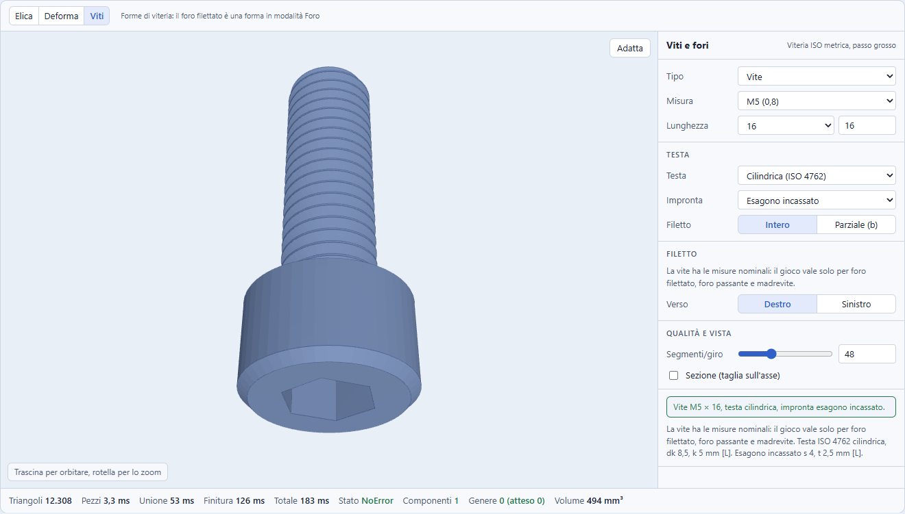

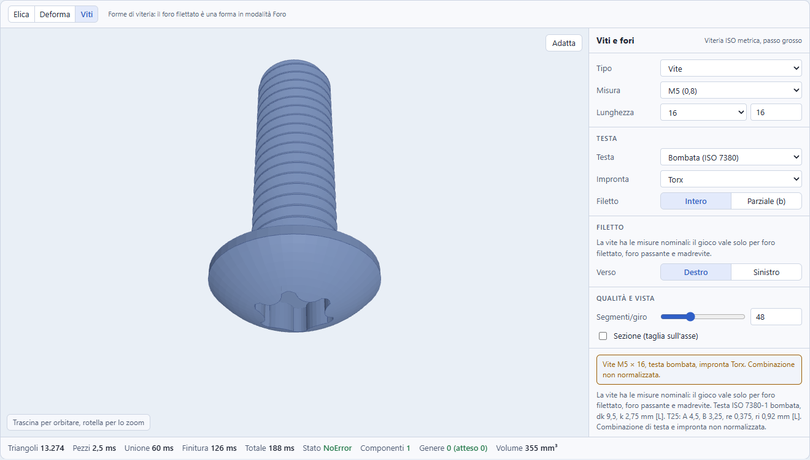

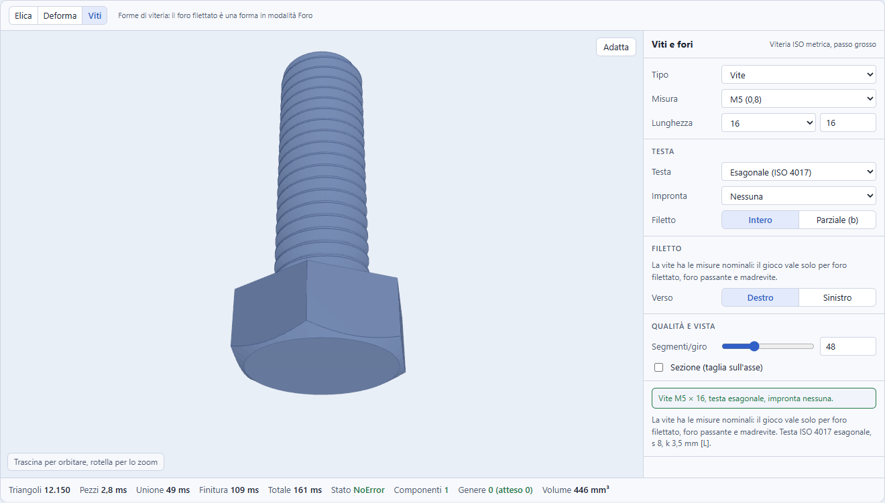

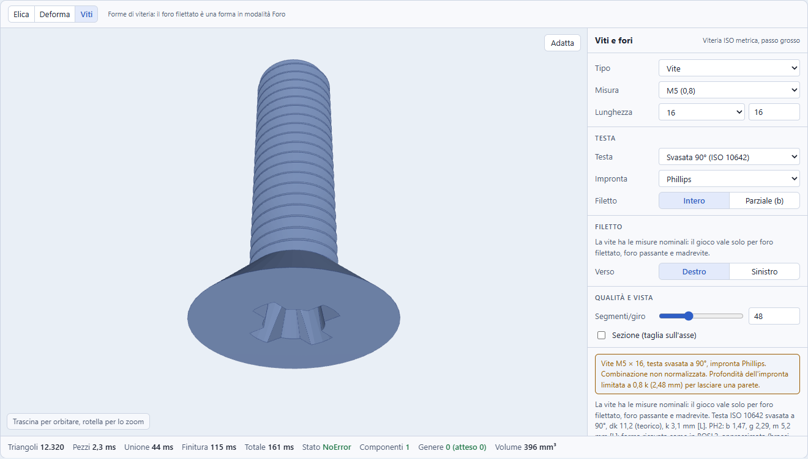

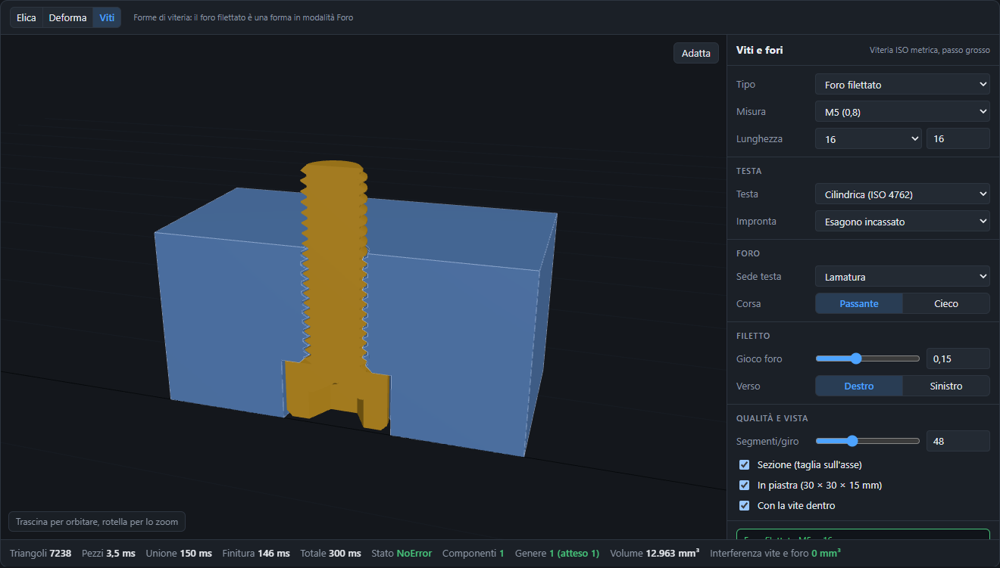

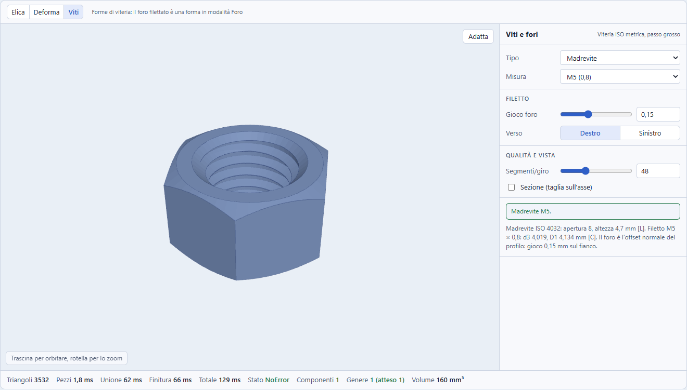

#### 11.5.2 Misure

Tutte le righe: stato `NoError`, una sola componente, genere atteso (vite 0, madrevite 1, piastra con foro passante 1, foro cieco in piastra 0). Mediane su 5 prove per M3, M5, M8 e M12 (M4, M6 e M10: una prova, stesse conclusioni); vite lunga 16 mm con filetto intero, 48 segmenti per giro. **I tempi sono indicativi**: la macchina era condivisa e variano di 2 o 3 volte tra serie; i triangoli sono la misura affidabile. Il dettaglio per riga (526 righe di dati, anche M4, M6 e M10 e lo sweep dei fori) è in [`docs/prototipi/misure-viti.txt`](prototipi/misure-viti.txt).

**Teste e impronte** (tutte le combinazioni valide, vite L = 16):

| Misura | Triangoli | Tempo | Note |
|---|---|---|---|
| M3 | da 25 166 a 26 290 | 228-266 ms | esagono incassato 25 348, Torx 25 578 (cilindrica) |
| M5 | da 12 130 a 13 274 | 133-154 ms | cilindrica senza impronta 12 236, con esagono 12 308, con Torx 12 538 |
| M8 | da 7 970 a 9 040 | 88-99 ms | solo nessuna, esagono e taglio (Phillips e Torx disattivati) |
| M12 | da 5 854 a 6 924 | 70-77 ms | idem |

L'impronta cambia i triangoli di meno di 350 in più o in meno (su alcune combinazioni li riduce, per esempio esagono e taglio sulla bombata, che tolgono materiale a una calotta già fitta; su altre li aumenta, come il Torx) e il tempo di pochi millisecondi: **il costo è nel filetto**, che non dipende da testa e impronta (sotto-cache di 11.5). Un M5 × 16 cilindrico con esagono pesa 12 308 triangoli; una M3 × 16 circa 25 mila, perché il passo di 0,5 mm vuole più giri.

**Filetto, fori, madrevite, vite parziale e vite lunga:**

| Caso | M3 | M5 | M8 | M12 |
|---|---|---|---|---|
| Filetto esterno L = 16 (triangoli, ms) | 24 920, 168 | 11 876, 111 | 7 712, 67 | 5 600, 49 |
| Utensile del foro filettato (triangoli, ms) | 15 658, 232 | 11 844, 196 | 7 706, 88 | 5 600, 51 |
| Foro filettato passante in piastra 30 × 30 × 15, genere 1 | 11 468, 228 | 7 238, 161 | 3 336, 87 | 1 242, 37 |
| Madrevite ISO 4032, genere 1 | 2 442, 83 | 3 532, 111 | 3 268, 94 | 3 892, 73 |
| Vite L = 40 con filetto parziale (b) | 28 598, 301 | 17 098, 201 | 14 204, 172 | 12 974, 148 |
| Foro passante ISO 273 medio | 188, 0 | 188, 0 | 188, 0 | 188, 0 |

**Viti lunghe** (filetto intero, una prova): M3 × 40 62 212 triangoli e 0,66 s; **M3 × 60 92 932 triangoli e 1,04 s** (423 ms di unione dei pezzi e 607 ms di finitura); M5 × 60 43 988 e 0,53 s; M8 × 60 28 426 e 0,32 s; M12 × 60 20 520 e 0,29 s. Una M3 lunga è la peggiore (il passo piccolo, 0,5 mm, dà 120 giri su 60 mm): **un ricalcolo di circa un secondo a ogni modifica** dei parametri, quindi la sotto-cache del filetto di 11.5 e l'anteprima semplificata (meno segmenti per giro) servono davvero per le viti sottili e lunghe. Non ho provato lunghezze oltre i 60 mm.

**Volumi contro la formula** (senza smusso né poligonazione, 48 lati): fusto liscio −0,29% (solo i 48 lati); testa svasata −0,29%; bombata −0,48%; esagonale da −0,76% a −0,91% (pesa lo smusso a 30°); cilindrica da −0,51% (M12) a −1,41% (M5) (48 lati e smusso di 0,3-0,5 mm); fusto filettato contro il cilindro al diametro medio d2 da +0,59% (M12) a +0,83% (M3). Sono scarti spiegati, non misure di errore del kernel.

**Un'anomalia trovata e corretta** (osservata nella prima esecuzione, non riportata nel file delle misure, che contiene solo il risultato finale senza anomalie). Nella prima esecuzione sette casi (M3 e M12 con esagono incassato o filetto sinistro) uscirono con due componenti e genere −1: il cono del fondo dell'esagono, appoggiato in tangenza al prisma, lasciava una cavità. Si corregge con un cilindretto di raggio 0,97·s/2 che entra nel prisma. **Per il kernel**: il fondo conico dell'impronta non deve toccare il prisma in tangenza, ma sovrapporlo.

#### 11.5.3 Accoppiamento di vite e foro

La prova: vite L = 20 con filetto intero, piastra 30 × 30 × 15 con il foro filettato e madrevite, **vite sempre nominale e gioco solo sul foro**. L'**interferenza** è il volume di `vite ∩ (piastra − foro)`; l'**ingaggio** è il volume della vite spostata di P/2 che entra nel materiale (quanto i denti si tengono).

| Misura | Ingaggio nel dado con gioco 0,15 | 0,10 | 0,075 | 0 | Gioco massimo con ingaggio |
|---|---|---|---|---|---|
| M3 | **0,086 mm³** | 0,348 | 0,516 | 1,125 | 0,189 mm (0,378 P) |
| M4 | 0,839 | 1,497 | 1,862 | 3,098 | 0,265 mm |
| M5 | 2,536 | 3,950 | 4,719 | 7,268 | 0,303 mm |
| M6 | 5,303 | 7,195 | 8,204 | 11,480 | 0,379 mm |
| M8 | 14,319 | 17,851 | 19,707 | 25,632 | 0,473 mm |
| M10 | 30,176 | 35,870 | 38,834 | 48,196 | 0,568 mm |
| M12 | 64,593 | 74,422 | 79,503 | 95,407 | 0,663 mm (0,379 P) |

- **Con gioco maggiore di 0 l'interferenza è esattamente 0** su tutte le misure (verso destro a 0,15, 0,10 e 0,075 mm; verso sinistro misurato solo a 0,15 mm, con lo stesso risultato); con gioco −0,1 mm è positiva (da 18,6 mm³ nella piastra M3 a 68,8 mm³ nella M12). Con gioco 0 non è zero (da 0,0005 a 0,063 mm³): i fianchi della vite e del foro sono triangolati in modo diverso, e va letto come rumore di triangolazione, non come compenetrazione.
- **La sovrapposizione radiale** (cresta della vite meno nucleo del foro) vale 0,5413 P − `gap`: 0,121 mm per M3 e 0,797 mm per M12 con 0,15 mm.
- **Come leggere l'ingaggio.** È un volume in mm³ e **non si confronta tra misure diverse** (il dado M3 è alto 2,4 mm, il M12 10,8 mm); include inoltre lo smusso d'imbocco a 45° (due facce nel dado, una nella piastra), che pesa fino alla metà dell'altezza del dado M3 (0,6 mm per lato contro 2,4 mm). Il confronto sensato è il **rapporto rispetto al gioco 0**: con 0,15 mm l'ingaggio che resta è il **7,6% nel dado M3** (0,086 contro 1,125 mm³) e il 27,7% nella piastra M3, contro il 46% e il 63% di M6 e il 68% e l'80% di M12. Una misura con un dado senza smussi non è stata fatta.
- **M3 è la misura più debole**: con gioco 0,15 mm l'ingaggio che resta è il più basso (7,6% nel dado), e il filetto smette di tenere a 0,189 mm. Sulle misure piccole un gioco predefinito unico probabilmente non basta (11.9), ma lo dice il rapporto, non il volume assoluto.
- **Il limite 0,378 P non è il limite 0,2165 P di 11.4.** Sono due grandezze: 0,2165 P (√3·P/8) è il gioco a cui il dente della madrevite **perde la cresta piatta** e finisce a punta; 0,378 P è il gioco, trovato per bisezione sull'ingaggio, oltre il quale i denti **non si toccano più**. Il primo è calcolato **[C]**, il secondo misurato nel prototipo e non derivato.
- **Un errore del primo giro, utile da sapere** (osservazione della prima passata del prototipo, **non riportata riga per riga** nel file delle misure: il codice attuale non può più riprodurla perché la vite ignora il gioco). Con il gioco applicato **sia** alla vite sia al foro il gioco si raddoppia: M3 non si agganciava (ingaggio 0) e M4 quasi (0,11 mm³). La regola di 11.3 (vite nominale, gioco sul foro) evita il raddoppio ed è quella provata qui; BOSL2 fa lo stesso (il gioco allarga il foro, mai la vite).
- Il chip «Interferenza vite e foro 0 mm³» del prototipo è un controllo di non compenetrazione, **non un indicatore di accoppiamento**: due solidi che non si toccano possono non tenere.

#### 11.5.4 Che cosa resta non provato

OpenSCAD non è installato in questa macchina (la coincidenza del volume del modulo esportato con quello del kernel non è provata, 11.6); nessuna stampa (gioco, impronta verso il piatto, ponte dell'esagono); Phillips approssimato e Torx a sei lobi non confrontati con una punta vera; lunghezze oltre i 60 mm; il filetto interno nei fori orizzontali e a goccia. Gli script di misura **non sono nel repository** (stavano in una cartella di lavoro temporanea): per rifare le misure va riscritta l'estrazione del blocco `CORE-BEGIN` e `CORE-END` del prototipo, che esegue le funzioni pure con il `manifold-3d` del progetto. Il file delle misure è `docs/prototipi/misure-viti.txt`.

### 11.6 Codice OpenSCAD e ritorno dall'import

**Modulo autosufficiente.** Si scrive **una sola volta in testa al file**, come previsto per `construct_helix` (sezione 5), un `module construct_screw(size, length, variant, head, drive, thread_length, gap, hand, segments)` che costruisce il filetto con un `polyhedron` per ogni mezzo giro dentro `union()`, le teste con `rotate_extrude` e `cylinder($fn = 6)`, le impronte con `polygon`, tutto dalle stesse tabelle del kernel. Si scrive solo se la scena contiene almeno una vite. Non si chiama BOSL2: il codice non sarebbe autosufficiente e, soprattutto, la geometria non coinciderebbe con quella del kernel (regola del progetto: i due devono restare coerenti). Il costo è un modulo lungo; la sua dimensione va misurata e dichiarata nel commento. Ogni vite esce come una chiamata leggibile, con i parametri nel Customizer:

```
// Vite M6x20
// construct:screw {"module":1,"size":6,"length":20,"variant":"screw","head":"cylinder","drive":"hex","gap":0.15,"hand":"right","segments":48}
construct_screw(size = 6, length = 20, variant = "screw", head = "cylinder", drive = "hex", gap = 0.15, hand = "right", segments = 48);
```

**Il foro esce dentro `difference()`**, come ogni foro (`groupLines`, `src/codegen/openscad.ts:517`); **un foro alla radice non sottrae nulla** e non esce nel codice (`solidsOf`, `:586`), e un foro dentro un Raggruppa non ha effetto: come il resto dell'app.

**Ritorno dall'import.** L'import **esegue** i moduli dell'utente e non legge `polyhedron` (`evaluate.ts:1055`): eseguito così com'è, il modulo darebbe una vite che sparisce con un avviso. Il riconoscimento deve avvenire **prima dell'esecuzione, per nome** (come `piatto_N`, `plateCall` a `evaluate.ts:1137`): in `callModule` (`evaluate.ts:1109`), prima del `modules.get` a `:1110`, per `s.name === 'construct_screw'`. Il commento `// construct:screw {...}` (letto come `// construct:path` da `parse.ts:104`) si **valida ricalcolando**, come fa `restorePath` per `// construct:path` (`pathMeta.ts:28`, tolleranza 1e-3 sui punti): il JSON del commento non è fidato, si decodifica e lo si normalizza con `normalizeScrew`; gli argomenti della chiamata, già valutati dall'import, devono coincidere con quelli del commento; **il modulo definito nel file** deve avere lo stesso albero sintattico del modulo che Construct scrive per la versione indicata nel commento (`"module":1`) (il confronto è sull'albero di `parse.ts`, non sul testo, ignorando i numeri di riga). Se il modulo è stato modificato a mano, la chiamata si esegue come codice dell'utente (con l'avviso del `polyhedron`). Se tutto torna, l'elemento diventa un nodo `screw`, con la matrice scomposta come per le altre primitive (`toScene.ts`): la scala diversa da 1 o lo specchio vengono segnalati con una nota e non si perdono in silenzio. **È una differenza dal precedente**: `restorePath` confronta i punti scritti, qui il confronto è sul modulo, perché la geometria sta dentro il modulo. È un punto da provare (andata e ritorno di tutte le varianti, compresi i fori dentro `difference()`).

**Verifica ancora da fare.** OpenSCAD non è installato in questa macchina: la **coincidenza del volume del codice esportato con quello del kernel non è provata**, come per l'elica (sezione 5). È il primo test della fase 4a.

### 11.7 Interfaccia

**Libreria.** Tre voci nelle Forme 3D: **Vite**, **Foro filettato**, **Madrevite**. La Vite nasce `screw` solida, il Foro filettato `tapped` con `mode: 'hole'`, la Madrevite `nut` solida. Sono tre pulsanti sullo stesso `kind`, quindi `addPrimitive(kind, at)` (`store.ts:277`) prende un terzo argomento con la variante e il modo iniziale, e il nome del nodo viene dall'etichetta del pulsante (`uniqueName`, `store.ts:285`). Le varianti `clearance` e `nutSeat` **non hanno un pulsante**: si ottengono con il selettore Variante delle Proprietà (domanda aperta: pulsanti «Foro passante» e «Sede del dado», che non sarebbero prefisso di altre etichette).

**Dove cade nelle fasce.** `SHAPES_3D` (`defaults.ts:64`) è ordinato per frequenza d'uso, con i solidi dei dadi in fondo; il test e2e fissa l'ordine esatto (`e2e/app.spec.ts:1637-1643`, titolo compreso: «mette i profilati dopo le primitive e il Dado in fondo»). Si propone di mettere le tre voci **dopo i profilati e prima del Dado**:

`Cubo, Cilindro, Sfera, Cono, Toro, Tubolare tondo, Tubolare rettangolare, Profilato a L, Profilato a U, Profilato a T, Profilato a H, Vite, Foro filettato, Madrevite, Dado`

così il Dado resta in fondo come dalla 0.66.0, e il test si aggiorna (elenco e titolo). Le icone: `Bolt` di `lucide-react` esiste (`node_modules/lucide-react/dist/esm/icons/bolt.mjs`) e può servire per Vite e Madrevite; il Foro filettato ha un'icona propria in `src/ui/icons/` come i profilati (`createLucideIcon`). Il menu contestuale legge le stesse liste (`ContextMenu.tsx:279-285`).

**Proprietà.** Un ramo `screw` in `PrimitiveFields` (`PropertiesPanel.tsx:476`, il ramo `die` è a `:604-632`). Il selettore della misura è un `<select>` come quello del Font con i `optgroup` (`:914`), o come `BED_PRESETS` in `BedDialog.tsx:43-48`: M3, M4, M5, M6, M8, M10, M12. Il Dado dà il modello per un valore discreto (`SliderField` con `nearestDieFaces`, `:604-632`), ma qui il selettore è più chiaro.

```
Vite                                       [Solido | Foro]
Variante    ( Vite | Foro filettato | Foro passante | Madrevite | Sede del dado )
Misura      [ M6        v ]   passo 1 mm, nucleo 4,773 mm
Lunghezza   [ 20 ] mm          (slider, passi da 1 mm)
Testa       [ Cilindrica (ISO 4762)   v ]
Impronta    [ Esagono incassato       v ]   Torx: T45 non tabellato (M8)
Filettatura ( Intera | Normale 24 mm | Personalizzata [ 12 ] mm )
Verso       ( Destro | Sinistro )
Gioco       [ 0,15 ] mm   (non per la Vite: foro filettato, passante, madrevite, sede del dado)
Segmenti/giro [ 48 ]
```

I campi vengono tutti da `fasteners.ts`: i valori accanto ai selettori (passo, nucleo, lunghezza filettata normale) sono calcolati, non memorizzati. Le combinazioni non valide si disattivano con la ragione scritta (11.3). **I campi numerici accettano formule** (`length`, `threadLength`, `gap`); la misura M no. I tooltip stanno in `src/ui/PropertiesPanel/tooltips.ts`.

**Tasto H.** Il tasto H (`useShortcuts.ts:115`) alterna Solido e Foro come per ogni oggetto. Per la Vite cambia **solo il ruolo**: una `screw` foro è la cavità di misure nominali (nessun gioco, 11.3), mentre il Foro filettato (`tapped`) nasce già foro. L'avvertenza «i fori hanno effetto solo dentro Unione, Differenza o Intersezione» (`PropertiesPanel.tsx:141`) vale anche qui, ed è il punto di attrito più probabile: un Foro filettato aggiunto da solo appare traslucido e non fa nulla finché non lo si mette in una Differenza con il pezzo.

**Menu contestuale.** Il comando Solido o Foro (`commands.tsx:221-226`) funziona senza modifiche; Raccordo, Smusso, Smusso angolare e anche **Appoggia su una faccia** (comando `layflat`) si nascondono per la Vite (`hasFlatFaces`, `commands.tsx:169`).

**Valori ricordati.** `lastValues.ts` ricorda misura, lunghezza, testa, impronta, gioco, verso e segmenti per la vite, con i campi stringa nel loro caso di `isValid` (11.3) e il normalizzatore dopo l'unione.

### 11.8 Stampa FDM

Tutte le affermazioni riportano la fonte; Sovol è la guida di stampa (**[L]** pagina letta).

- **Gioco**: **0,10-0,20 mm per lato** (0,2-0,4 mm sul diametro) **[L Sovol]**; rcolyer usa tolerance 0,4 **[L]**; MakerWorld 0,15 **[A]**; BOSL2 `$slop` fa crescere il foro di 4·`$slop` **[L]**. Il valore iniziale di Construct è **0,15 mm perpendicolare al fianco** (11.4).
- **Misura minima**: i filetti stampati sono affidabili da **M6** con l'ugello da 0,4, e da M2 a M5 conviene l'**inserto a caldo** **[L Sovol]**; per rcolyer i filetti interni funzionano da M2, quelli esterni da M4 (M3 è critico) **[L]**. Si propone un **avviso di stampabilità** sotto M6 (come l'avviso sulle spire sotto l'ugello, sezione 7), e un avviso sul gioco quando supera il limite del profilo scelto per l'utensile del foro (0,1443 P con il profilo della vite, 0,2165 P con il profilo ISO interno) e il dente perde la cresta (11.4).
- **Profilo**: il 60° ha creste sottili e sbalzi (il fianco inferiore è inclinato di 30° dal piano, cioè 60° dalla verticale **[C]**); le alternative per FDM sono il trapezoidale o ACME, i fianchi a 45°, la cresta piatta di almeno 0,3 mm e i raccordi alla radice di 0,2-0,5 mm **[L Sovol, DurbansPoison, BOSL2; MakerWorld A]**. Construct tiene il **profilo ISO a 60°** perché deve accoppiarsi con la viteria vera; un profilo per FDM con fianchi a 45° è un'opzione futura, valida solo per coppie stampate.
- **Altezza dello strato** al massimo P/6-P/8, **imbocco smussato a 45°** profondo 0,8-1,5 mm, raccordo al fondo 0,2-0,5 mm, impegno del filetto 2-2,5·d **[L Sovol]**.
- **Orientamento**: asse della vite **verticale** (profilo circolare) e viti con la **testa sul piano** **[L Sovol; A MakerWorld]**; in orizzontale la vite è più resistente ma richiede supporti. Con la testa sul piatto **l'impronta guarda il piatto**: l'apertura dell'esagono sta sul piano e il suo fondo conico è un soffitto, un ponte con sbalzo (la prassi è un ponte sacrificale alto un layer, **[A forum Prusa e Bambu]**): da provare in stampa, e per questo il kernel non decide l'orientamento.
- **Fori orizzontali**: a **goccia** (punta a 45°) o poligono, come `teardrop` in BOSL2 e `screw_tearsink` di NopSCADlib **[L]**; è prassi comune **[M]**. Il modello dati di 11.3 **non la prevede**: sarebbe un campo `teardrop: boolean` aggiunto dopo la prima versione (11.9).
- **Sede del dado**: da s + 0,3 a s + 0,4 mm e profondità m + 0,2 mm; ponte sacrificale alto un layer, con la sede più alta per compensare il cedimento **[A York, forum Prusa e Bambu]**.
- **Ponti**: l'esagono incassato e la sede del dado sono ponti: valgono le indicazioni sopra.
- **Inserti a caldo** (alternativa sotto M6, **lacuna**: nessuna tabella ISO, i valori dipendono dal produttore): M3 4,0 (Albany) o 5,0 (Stanford), M4 5,3-5,7 **[A]**, CNC Kitchen M4 5,7, M5 6,5, M6 8,1 **[A]**; il foro **1 mm più profondo** dell'inserto **[L CNC Kitchen]**; foro per auto-maschiare la vite nella plastica M3 2,6 e M4 3,6 **[L Stanford]**. Per questo l'inserto è **parametrico** (diametro e profondità liberi), non una tabella: una variante `insert` è fuori dalla prima versione.

### 11.9 Rischi e domande aperte

| Rischio | Gravità | Mitigazione |
|---|---|---|
| Il gioco predefinito toglie la cresta piatta al dente della madrevite: su M3, M4, M5 e M6 con il profilo della vite per l'utensile (limite 0,1443 P), solo su M3 con il profilo ISO interno (limite 0,2165 P, M4 al limite) (11.4) | Media | Misurato (11.5.3): con gioco 0,15 mm l'ingaggio che resta rispetto al gioco 0 è il 7,6% nel dado M3, contro il 46% di M6 e il 68% di M12 (è un rapporto: il volume assoluto non si confronta tra misure, e include gli smussi d'imbocco); il filetto smette di tenere a 0,378 P (M3 0,189 mm). Gioco predefinito per misura (più basso su M3 e M4), avviso oltre il gioco massimo, prova di stampa |
| Phillips e Torx con tabelle incomplete (PH4, T45, T50, T55; A di T55 non trovato, A di T45 e T50 solo per attribuzione a memoria) | Media | Nessuna estrapolazione: impronta disattivata da M8 con la ragione scritta; completare con ISO 4757, ISO 10664 o un catalogo letto |
| Tabelle ISO prese da cataloghi, non dalla norma; discordanze ISO e DIN (10642 e 7991; 7045 e 7985; s di M10 e M12; dado M6 5,2 e 5,0) | Media | Livello di verifica per ogni valore (Appendice B); le righe incerte si ricontrollano con la norma prima del rilascio |
| Coerenza kernel e codice: il modulo OpenSCAD deve dare la stessa geometria, e OpenSCAD non è installato | Alta | Test di volume e ingombro contro OpenSCAD in locale (primo test della fase 4a); stessi dati da `fasteners.ts` |
| Ritorno dall'import: il riconoscimento si fida di un modulo e di un commento; il file può essere modificato a mano | Media | Commento validato ricalcolando, confronto dell'albero del modulo, versione del modulo nel commento; altrimenti si esegue come codice dell'utente |
| Costo di ricalcolo: viti lunghe e grosse hanno decine di giri (sezione 4.1) e cambiare testa o impronta rifarebbe il filetto | Media | Sotto-cache del filetto, segmenti per giro regolabili, misure di 11.5 |
| `VERSION = 8` una sola volta: se elica, Deforma e `screw` escono in rilasci diversi, una build con `VERSION = 8` ma senza `screw` accetta un file con `screw`; `primitive()` non ha `default` e fallirebbe | Media | Rilasciare i tipi insieme, oppure alzare `VERSION` a ogni tipo, oppure un `default` che rifiuta il nodo con un errore pulito |
| Prima primitiva non centrata sull'origine: `halfHeight`, gizmo di scala, appoggio e «Appoggia su una faccia» suppongono un ingombro centrato | Media | `halfHeight` = altezza della testa; test sul gizmo (`SceneObject.tsx:383`, `:417`) e sui comandi di appoggio |
| Punti con un ramo predefinito che non dà errore al compilatore (`nominalSize`, `isValid`, `stretchFactors`, `brushSegments`, `isExactShape`, `hasFlatFaces`) | Media | Elenco di 11.3 e un test per ciascuno |
| Nome del campo `size` già usato da Dado, Testo e Cubo: `isValid` non può garantire la lista ISO | Bassa | `normalizeScrew` dopo i valori ricordati; oppure campo `diameter` |
| L'impronta guarda il piatto con la testa sul piano: stampa dell'impronta e del fondo conico | Media | Prova di stampa; indicazione nel tooltip; ponte sacrificale |
| Misure tabellate non verificate (ISO 4753, ISO 15065, ISO 2009 dk teorico, b di ISO 7380-1, m del dado M6) e inserti senza tabella | Bassa | Dichiarate in Appendice B e nei metodi (regole pratiche) |
| Il Foro filettato creato da solo non fa nulla (un foro alla radice non sottrae) | Bassa | Nota nelle Proprietà; il flusso è quello dei connettori di Dividi |
| Il modulo OpenSCAD cambia tra versioni di Construct | Bassa | Numero di versione del modulo nel commento; l'import conosce le versioni precedenti |
| Ordine della libreria e test e2e | Bassa | Aggiornare `e2e/app.spec.ts:1637` e il titolo del test |

**Domande aperte.**

- **Nome del campo**: `size` (decisione presa) o `diameter`, per il conflitto di `isValid` con Dado, Testo e Cubo.
- **Sede del dado**: quinta variante `nutSeat` (proposta, fuori dal modello già deciso) oppure `mode` nella chiave di cache solo per `screw`; **Foro passante e Sede del dado in libreria**: solo con il selettore Variante, oppure con pulsanti propri.
- **Testa per impronta**: misure della testa che seguono la norma della combinazione (proposta, lettura b) o testa fissa per forma (lettura a).
- **Valori iniziali**: misura e lunghezza (proposta M6 per 20 mm), segmenti per giro, gioco massimo ammesso e regola della lamatura.
- **Serie ISO 273** (fine, media, larga) come selettore, invece di d + 2·`gap`.
- **Profilo dell'utensile del foro**: dal profilo della vite (d3) o dal profilo ISO interno (D1), che è quello usato dal prototipo e la coppia della norma: cambia il limite del gioco (11.4).
- **Gioco predefinito per misura**: 0,15 mm unico (proposta iniziale) oppure più basso su M3 e M4, dove l'ingaggio che resta rispetto al gioco 0 è il più basso (11.5.3).
- **Gioco dell'impronta**: l'esagono incassato senza gioco (proposta) oppure `gap` esteso anche alla vite per l'impronta.
- **Orientamento del foro**: origine sul piano di appoggio della testa e testa verso -Z (da ruotare di 180° per aprirlo verso l'alto), oppure il contrario.
- **Fori orizzontali**: campo `teardrop` nella prima versione o dopo.
- **Lunghezza libera o serie normalizzata** (5, 6, 8, 10, 12, 16, 20, 25, 30, 35, 40, 45, 50, 55, 60, 65, 70, 80, 90, 100 mm: letta per 8-70, ISO 888 ritirata, Appendice B): la proposta è libera, con la serie come suggerimento.
- **Alzata di `VERSION`**: una sola per tutti i tipi, a patto che escano insieme, o una per tipo.
- **Raccordo e smusso sulla vite**: nascosti (proposta) o consentiti.
- **Passo fine, inserti a caldo, profilo FDM a 45°, filetti sinistri nei fori**: fuori dal primo giro.

## Appendice A: due scoperte emerse durante lo studio

Aggiornamento del 17 ottobre 2026: **entrambe le scoperte sono state trattate dalla 0.67.0** e non descrivono più un problema aperto. Il testo originale è riscritto qui sotto dichiarando che cosa è cambiato.

**`revolve` e i segmenti con un angolo parziale: risolto in 0.67.0, verificato nel sorgente di OpenSCAD.** La misura su manifold 3.5.4 **resta vera**: `Manifold.revolve(profilo, segmenti, angolo)` usa `segmenti` divisioni **sull'arco intero**, qualunque sia l'angolo (48 segmenti danno 48 divisioni a 360°, 180°, 90° e 45°). Lo studio del 16 ottobre registrava una discrepanza: il kernel passava `segments` così com'era, mentre il codice esportato è `rotate_extrude(angle = ..., $fn = segments)` e in OpenSCAD `$fn` si scala con l'angolo. Nel sorgente di OpenSCAD `getCircularSegmentCount` calcola `ceil(fn) * |angolo| / 360` (`src/core/CurveDiscretizer.cc`) e `rotate_extrude` gli passa l'angolo (`src/geometry/rotate_extrude.cc`): una rotazione di 90° con 64 segmenti aveva 64 lati nel kernel e 16 nel codice. La 0.67.0 ha allineato il kernel: `Manifold.revolve(moved, Math.max(3, Math.ceil((segments * angle) / 360)), angle)` (`src/kernel/evaluate.ts:448-450`), quindi `segments` vale per il giro intero come `$fn`, e anche l'importazione di `$fn` da file di terzi coincide. Il costo accettato è dichiarato nel CHANGELOG: i progetti salvati con una rotazione parziale ottengono una mesh più grossolana (stessa forma, meno facce; si alza Segmenti per riaverle), senza migrazione. Il toro (`section.revolve(p.segments)`, `evaluate.ts:191`) fa un giro intero e non è toccato. Per questo studio ne segue che il pezzo da mezzo giro dell'elica usa già la regola corretta e che la domanda aperta sui segmenti è chiusa.

**Il tetto di `twistDivisions` (360) e il cursore (±3600°): misurato, non è un difetto.** Lo studio del 16 ottobre sosteneva che oltre 720° ogni strato supera i 2° e che riappare il difetto dei profili sottili descritto in `twist.ts` (volume gonfio o svuotato fino al 14% se i lati lunghi non si spezzano; il difetto è stato scoperto con l'esempio Bauble, descritto in `docs/da-fare.md` nella sezione sull'import OpenSCAD, e `twist.ts` ne contiene la correzione), da risolvere con un budget di triangoli. La 0.67.0 ha misurato il contrario sul caso peggiore, un profilo sottile 60 × 5 × 40 mm (volume esatto 12 000 mm³): errore di -0,19% a 3600°, +0,03% a 1800°; portare gli strati a 1800 darebbe +0,05% con quattro volte i triangoli. Il tetto resta e un test lo fissa sotto l'1% (`src/kernel/evaluate.test.ts:260`). Il difetto descritto in `twist.ts` riguarda i lati lunghi del profilo, che `subdivideContours` spezza già, non il numero di strati. Il budget di triangoli (sezione 4.4) serve solo al nuovo gruppo Deforma, la cui pipeline è diversa (raffinamento assiale e laterale di una mesh già costruita, non `subdivideContours`).

## Appendice B: tabelle ISO

Tabelle in forma copiabile per `src/scene/fasteners.ts`, raccolte il 17 ottobre 2026 (misure in mm, per M3, M4, M5, M6, M8, M10, M12 salvo diversa indicazione). **Le norme ISO non sono state lette direttamente**: ogni valore viene da cataloghi e pagine che le riproducono (fasteners.eu, fasten.it, Wikipedia, Optimas, Engineering Toolbox, AmesWeb, Engineers Edge, BOSL2) e prima del rilascio le righe incerte vanno ricontrollate sulla norma. Livello di verifica: **[L]** pagina letta direttamente, **[A]** solo anteprima di ricerca, **[C]** calcolato da formula, **[M]** valore a memoria non verificato. Dove non è scritto, il livello della tabella vale per tutte le sue righe.

### B.1 Filetto ISO metrico (passo grosso)

Profilo di base **[L Wikipedia ISO metric screw thread]**: H = 0,866025 P; cresta troncata a H/8 (lato del diametro maggiore) e fondo a H/4; profondità di base 5H/8 = 0,54127 P; D1 = d - 1,082532 P; d2 = D2 = d - 0,649519 P. Vite reale (ISO 965-1): raccordo di fondo R = H/6 = 0,1443 P e profondità h3 = 17H/24 = 0,61343 P, quindi **d3 = d - 1,22687 P** (formula **[M]**, valori **[C]**; confermata numericamente solo per M2,5, d3 = 1,948 **[A]**). **Attenzione**: 0,5413 P è la profondità di base, non quella della vite vera.

| d | P grosso | P fine (non usato dal modello) | d2 [C] | d3 vite [C da formula M] | D1 madrevite [C] | Punta, passo grosso [L] | Punta, passo fine [L] |
|---|---|---|---|---|---|---|---|
| M3 | 0,5 | 0,35 | 2,675 | 2,387 | 2,459 | 2,5 | 2,65 |
| M4 | 0,7 | 0,5 | 3,545 | 3,141 | 3,242 | 3,3 | 3,5 |
| M5 | 0,8 | 0,5 | 4,480 | 4,019 | 4,134 | 4,2 | 4,5 |
| M6 | 1 | 0,75 | 5,350 | 4,773 | 4,917 | 5,0 | 5,25 |
| M8 | 1,25 | 1 oppure 0,75 | 7,188 | 6,466 | 6,647 | 6,8 (Optimas: 6,75) | 7,0 |
| M10 | 1,5 | 1,25 oppure 1 | 9,026 | 8,160 | 8,376 | 8,5 | 8,75 |
| M12 | 1,75 | 1,5 oppure 1,25 | 10,863 | 9,853 | 10,106 | 10,2 | 10,5 |

Passi: Wikipedia ISO 262 **[L]**. Punte: Engineering Toolbox e Optimas **[L]**; regola pratica: punta ≈ d - P. Tolleranze 6g e 6H (DIN 13, Ganter) **[A]**: scostamenti di 20-30 µm, irrilevanti per l'FDM. Il passo fine non è usato dal modello (11.3), ma è riportato perché la ricerca lo ha raccolto.

**Valori derivati dal profilo per il gioco normale** (11.4), tutti **[C dal profilo con h3 [M]]**: dente trapezoidale con cresta P/8, altezza (d - d3)/2 = 17H/24, base 5P/6 sul nucleo, vano piatto P/6; gioco massimo prima che i denti dell'utensile si tocchino con l'utensile dal profilo della vite: g = H/6 = 0,1443 P (M3 0,072; M4 0,101; M5 0,115; M6 0,144; M8 0,180; M10 0,217; M12 0,253); con l'utensile dal profilo ISO interno (cresta della madrevite a D1, vano P/4): g = √3·P/8 = 0,2165 P (M3 0,108; M4 0,152; M5 0,173; M6 0,217; M8 0,271; M10 0,325; M12 0,379).

### B.2 ISO 4762: testa cilindrica con esagono incassato **[L fasteners.eu/standards/ISO/4762]**

| | M3 | M4 | M5 | M6 | M8 | M10 | M12 |
|---|---|---|---|---|---|---|---|
| dk | 5,5 | 7 | 8,5 | 10 | 13 | 16 | 18 |
| k | 3 | 4 | 5 | 6 | 8 | 10 | 12 |
| s (esagono) | 2,5 | 3 | 4 | 5 | 6 | 8 | 10 |
| t min | 1,3 | 2 | 2,5 | 3 | 4 | 5 | 6 |
| b (lunghezza filettata) | 18 | 20 | 22 | 24 | 28 | 32 | 36 |
| da max | 3,6 | 4,7 | 5,7 | 6,8 | 9,2 | 11,2 | 13,7 |

**b = 2d + 12**, non 2d + 6. Lunghezza minima tabellata **[L]**: 5, 6, 8, 10, 12, 16, 20 mm. Per l'esagono incassato e = 1,15 s circa (ISO 4762: e min = 2,873 per s = 2,5, cioè 1,149 s **[L]**).

### B.3 ISO 7380-1: testa bombata con esagono incassato **[L fasten.it ISO 7380-1 (2011), uguale su fasteners.eu]**

| | M3 | M4 | M5 | M6 | M8 | M10 | M12 |
|---|---|---|---|---|---|---|---|
| dk | 5,7 | 7,6 | 9,5 | 10,5 | 14 | 17,5 | 21 |
| k | 1,65 | 2,2 | 2,75 | 3,3 | 4,4 | 5,5 | 6,6 |
| s | 2 | 2,5 | 3 | 4 | 5 | 6 | 8 |
| t min | 1,04 | 1,3 | 1,56 | 2,08 | 2,6 | 3,12 | 4,16 |

La lunghezza filettata b **non è stata letta** per questa norma: nel modello si assume come la ISO 4762 **[M]**.

### B.4 ISO 10642: testa svasata a 90° con esagono incassato **[L fasten.it ISO 10642 (02/2020)]**

| | M3 | M4 | M5 | M6 | M8 | M10 | M12 |
|---|---|---|---|---|---|---|---|
| dk teorico max | 6,72 | 8,96 | 11,2 | 13,44 | 17,92 | 22,4 | 26,88 |
| dk min (reale) | 5,54 | 7,53 | 9,43 | 11,34 | 15,24 | 19,22 | 23,12 |
| k max | 1,86 | 2,48 | 3,1 | 3,72 | 4,96 | 6,2 | 7,44 |
| s | 2 | 2,5 | 3 | 4 | 5 | 6 | 8 |
| t min | 1,1 | 1,4 | 1,75 | 2,2 | 2,9 | 3,5 | 4,3 |
| b | 18 | 20 | 22 | 24 | 28 | 32 | 36 |

Controllo **[C]**: k = (dk teorico - d)/2 per tutte le sette misure (1,86; 2,48; 3,1; 3,72; 4,96; 6,2; 7,44), coerente con l'angolo di 90° tra i fianchi. **Attenzione: la DIN 7991 è diversa** (dk 6, 8, 10, 12, 16, 20, 24; k 1,7, 2,3, 2,8, 3,3, 4,4, 5,5, 6,5) **[L fasteners.eu]**: la pagina etichettata «ISO 10642» di fasteners.eu riporta la DIN 7991. Per il modello si usa il dk teorico della ISO 10642.

### B.5 ISO 4017 (tutto filettato) e ISO 4014 (filettatura parziale): testa esagonale **[L fasteners.eu]**

| | M3 | M4 | M5 | M6 | M8 | M10 | M12 |
|---|---|---|---|---|---|---|---|
| s ISO | 5,5 | 7 | 8 | 10 | 13 | 16 | 18 |
| s DIN 933 e 931 | 5,5 | 7 | 8 | 10 | 13 | **17** | **19** |
| k | 2 | 2,8 | 3,5 | 4 | 5,3 | 6,4 | 7,5 |
| e min (classe A) | 6,01 | 7,66 | 8,79 | 11,05 | 14,38 | 17,77 | 20,03 |
| dw min | 4,57 | 5,88 | 6,88 | 8,88 | 11,63 | 14,63 | 16,63 |
| a max sottotesta (ISO 4017) | 1,5 | 2,1 | 2,4 | 3 | 4 | 4,5 | 5,3 |
| b ISO 4014, l ≤ 125 | 12 | 14 | 16 | 18 | 22 | 26 | 30 |

**s esagonale ISO e DIN differiscono per M10 e M12** (16 e 18 contro 17 e 19): il modello usa la ISO. b della ISO 4014 **[L]**: 2d + 6 per l ≤ 125, 2d + 12 per 125 < l ≤ 200, 2d + 25 oltre. La quota k è riportata una sola volta: per la ISO 4014 non è stata verificata separatamente. La diagonale dell'esagono (distanza tra spigoli opposti) è s/cos 30° = 1,1547 s **[C]**; il diametro circoscritto usato per costruire il contorno è r = s/√3 **[C]**.

### B.6 Teste con taglio **[L fasten.it (2011)]**

Larghezza del taglio n uguale per tutte le teste: M3 0,8; M4 1,2; M5 1,2; M6 1,6; M8 2; M10 2,5 (nessun valore per M12).

| | M3 | M4 | M5 | M6 | M8 | M10 |
|---|---|---|---|---|---|---|
| ISO 1207 cilindrica, dk / k / t min | 5,5 / 2 / 0,85 | 7 / 2,6 / 1,1 | 8,5 / 3,3 / 1,3 | 10 / 3,9 / 1,6 | 13 / 5 / 2 | 16 / 6 / 2,4 |
| ISO 1580 pan, dk / k / t min | 5,6 / 1,8 / 0,7 | 8 / 2,4 / 1 | 9,5 / 3 / 1,2 | 12 / 3,6 / 1,4 | 16 / 4,8 / 1,9 | 20 / 6 / 2,4 |
| ISO 2009 svasata, dk reale / k / t min | 5,5 / 1,65 / 0,6 | 8,4 / 2,7 / 1 | 9,3 / 2,7 / 1,1 | 11,3 / 3,3 / 1,2 | 15,8 / 4,65 / 1,8 | 18,3 / 5 / 2 |

Il dk **teorico** di ISO 2009 e ISO 7046 dovrebbe essere 6,3, 9,4, 10,4, 12,6, 17,3, 20 **[M]**: non trovato in nessuna fonte, quindi la svasatura per la testa con taglio usa il dk reale più il margine, finché il valore teorico non è letto.

### B.7 Croce Phillips

**ISO 7045 pan con croce.** I valori di fasten.it (dk 6, 8, 10, 12, 16, 20; k 2,4, 3,1, 3,8, 4,6, 6, 7,5) sono in realtà quelli della **DIN 7985** **[L fasteners.eu]**: **non vanno usati come ISO 7045**. Per la ISO 7045 il consigliato è dk 5,6, 8, 9,5, 12, 16, 20 e k 2,4, 3,1, 3,7, 4,6, 6, 7,5 **[M]** (coerente con ISO 1580 e ISO 14583, stessa forma). Numero della croce: M3 = PH1, M4 = PH2, M5 = PH2, M6 = PH3, M8 = PH4, M10 = PH4. Diametro dell'impronta m (tipo H) **[L]**: 3, 4,4, 4,9, 6,9, 9, 10,1 per M3-M10.

**ISO 7046 svasata con croce** **[L]**: testa come la ISO 2009, croce 1, 2, 2, 3, 4, 4, m (tipo H) 3,2, 4,6, 5,2, 6,8, 8,9, 10; la pagina fasten.it indica la norma come **ritirata**.

**Impronta ISO 4757, tipo H** **[L fasteners.eu e BOSL2]**:

| Croce | b | e | g | r | α | β |
|---|---|---|---|---|---|---|
| PH1 | 0,97 | 0,41-0,46 | 1,27 | 0,5 | 138° | 7° |
| PH2 | 1,47 | 0,79-0,84 | 2,29 | 0,6 | 140° | 5°45' |
| PH3 | 2,41 | 1,98-2,03 | 3,81 | 0,8 | 146° | 5°45' |

**PH4 non è tabellato** (serve per M8 e M10). Costruzione 3D secondo BOSL2 **[L]**: cono centrale con fianchi a 26,5° dall'asse, che sale dal diametro g del fondo fino al diametro dell'impronta; punta conica con fianchi a 28°; quattro bracci di larghezza b con angolo tra le facce γ = 92°; il diametro alla profondità p è d = 2·tan(26,5°)·(p - h1) + g con h1 = (g/2)·tan(28°).

### B.8 Torx (ISO 10664) e teste con Torx

**Dimensioni dell'impronta.** A (esterno) e B (interno) da Engineers Edge **[L]**; re, ri e profondità H da BOSL2 **[L]**:

| T | A (esterno) | B (interno) | re | ri | Profondità H (BOSL2) |
|---|---|---|---|---|---|
| T10 | 2,80 | 2,05 | 0,229 | 0,598 | 1,142 |
| T15 | 3,35 | 2,40 | 0,267 | 0,716 | 1,2 |
| T20 | 3,95 | 2,85 | 0,305 | 0,859 | 1,4 |
| T25 | 4,50 | 3,25 | 0,375 | 0,920 | 1,61 |
| T30 | 5,60 | 4,05 | 0,451 | 1,194 | 2,22 |
| T40 | 6,75 | 4,85 | 0,546 | 1,428 | 2,63 |

Approssimazioni di Engineers Edge **[L]**: B ≈ 0,72 A, re ≈ 0,1 A, ri ≈ 0,175 A. **T45, T50 e T55 (M8, M10, M12) non sono tabellati.** Un indizio: la tabella delle teste svasate ISO 14582 riporta A = 7,93 e 8,95 per M8 e M10 **[L]**, che corrispondono a T45 e T50 solo per un'attribuzione a memoria **[M]** (la tabella di Engineers Edge letta si ferma a T40); per T55 (M12) non è stata trovata nessuna misura A. B, re e ri si ricaverebbero solo con le approssimazioni, e quindi **non si usano** senza una fonte letta. Contorno 2D come in BOSL2 **[L]**: cerchio base di diametro A - 2·re; sei cerchi di raggio re centrati a raggio (A - 2·re)/2 a 0°, 60°, 120° e così via, uniti al cerchio base con un inviluppo convesso; poi si sottraggono sei cerchi di raggio ri centrati a raggio B/2 + ri e ruotati di 30° rispetto ai lobi.

**Teste con Torx** **[L fasten.it ISO 14579 (2011), ISO 14583 (2011), ISO 14582 (2014)]**:

| | M3 | M4 | M5 | M6 | M8 | M10 | M12 |
|---|---|---|---|---|---|---|---|
| ISO 14579 cilindrica, dk / k | 5,5 / 3 | 7 / 4 | 8,5 / 5 | 10 / 6 | 13 / 8 | 16 / 10 | 18 / 12 |
| ISO 14579, impronta T e t min-max | T10, 1,01-1,27 | T20, 1,42-1,8 | T25, 1,65-2,03 | T30, 2,02-2,42 | T45, 2,92-3,31 | T50, 3,62-4,02 | T55, 4,82-5,21 |
| ISO 14583 pan, dk / k | 5,6 / 2,4 | 8 / 3,1 | 9,5 / 3,7 | 12 / 4,6 | 16 / 6 | 20 / 7,5 | n.d. |
| ISO 14583, T e t max | T10, 1,27 | T20, 1,66 | T25, 1,91 | T30, 2,42 | T45, 3,18 | T50, 4,02 | n.d. |
| ISO 14582 svasata, dk teorico / k | 7,4 / 2,2 | 10,02 / 3,01 | 12 / 3,5 | 14,44 / 4,22 | 19,38 / 5,69 | 23 / 6,5 | n.d. |
| ISO 14582, A e t min | 2,8 / 0,92 | 3,95 / 1,30 | 4,5 / 1,50 | 5,6 / 1,83 | 7,93 / 2,60 | 8,95 / 2,91 | n.d. |

ISO 14582: la pagina **non indica il numero T**. A = 2,8, 3,95, 4,5 e 5,6 coincidono con T10, T20, T25 e T30 della tabella di Engineers Edge **[C]**; A = 7,93 e 8,95 non compaiono in quella tabella (si ferma a T40) e si attribuiscono a T45 e T50 **a memoria [M]**. Per M12 le teste pan e svasata con Torx non sono tabellate (n.d.).

### B.9 Dadi: ISO 4032 **[L fasten.it (2013), verificato su fasteners.eu]**

| | M3 | M4 | M5 | M6 | M8 | M10 | M12 |
|---|---|---|---|---|---|---|---|
| s | 5,5 | 7 | 8 | 10 | 13 | 16 | 18 |
| m max | 2,4 | 3,2 | 4,7 | **5,2** (fasten.it: 5,0) | 6,8 | 8,4 | 10,8 |
| e min | 6,01 | 7,66 | 8,79 | 11,05 | 14,38 | 17,77 | 20,03 |

**Dado M6**: le fonti discordano (5,2 contro 5,0); si consiglia m = 5,2, il massimo, per l'alloggiamento. ISO 4033 (dado alto) parte da M5, m max M5 5,1, M6 5,7, M8 7,5, M10 9,3, M12 12 **[A]**. La smussatura a 30° e il diametro della faccia d'appoggio del dado non sono stati letti.

**Alloggiamento del dado nel pezzo stampato** **[A]**: da s + 0,3 a s + 0,4 mm sulla misura tra le facce piane; profondità m + 0,2 mm; M3 5,8 per un dado da 5,5 e M4 7,3 per un dado da 7 (Stratasys F170 in ASA, Università di York).

### B.10 Fori passanti ISO 273 (fine, medio, largo) **[L Optimas]**

| | M3 | M4 | M5 | M6 | M8 | M10 | M12 |
|---|---|---|---|---|---|---|---|
| fine | 3,2 | 4,3 | 5,3 | 6,4 | 8,4 | 10,5 | 13 |
| medio | 3,4 | 4,5 | 5,5 | 6,6 | 9 | 11 | 14 |
| largo | 3,6 | 4,8 | 5,8 | 7 | 10 | 12 | 15 |

Indicazioni per la stampa: foro passante M3 3,2 (Prusa) o 3,3 (York), M4 4,2 o 4,3 **[L Stanford SSI; A York]**.

### B.11 Lamatura e svasatura

**Lamatura per ISO 4762** **[L AmesWeb, Machinery's Handbook]**: diametro M3 6,5, M4 8,25, M5 9,75, M6 11,25, M8 14,25, M10 17,25, M12 19,25; profondità uguale a d. La serie DIN 974-1 **non è verificata [M]**. Per l'FDM: diametro dk + 0,6-1,0 mm e profondità k + 0,2-0,5 mm **[M]**, dalla prassi.

**Svasatura a 90°**: **nessuna tabella ISO 15065 trovata**. Metodo: dk teorico + 0,2-0,4 mm, con il dk teorico da ISO 10642, ISO 14582 o ISO 7721. Riferimenti da utensile, non da norma **[A]**: 6,4, 8,4, 10,4, 12,5, 16,5 mm.

### B.12 Lunghezze, filettatura, punta e sottotesta

- **Serie normalizzata delle lunghezze**: 5, 6, 8, 10, 12, 16, 20, 25, 30, 35, 40, 45, 50, 55, 60, 65, 70, 80, 90, 100 (da 8 a 70 lette su fasteners.eu ISO 10642 **[L]**); la ISO 888 è **ritirata [A]**.
- **Lunghezza minima tabellata ISO 4762** **[L]**: M3 5, M4 6, M5 8, M6 10, M8 12, M10 16, M12 20.
- **Lunghezza filettata b**: ISO 4762 e ISO 10642 **b = 2d + 12** (18, 20, 22, 24, 28, 32, 36 **[L]**); ISO 4014 b = 2d + 6 per l ≤ 125, 2d + 12 per 125 < l ≤ 200, 2d + 25 oltre **[L]**; **non vale 2d + 6 per la ISO 4762**. Per le viti ISO 4762 corte la ISO prescrive la filettatura totale; le formule lg = l - b e ls = lg - 5P **non sono verificate [M]**.
- **Sottotesta (filetto incompleto)**: ISO 4017 a max 1,5, 2,1, 2,4, 3, 4, 4,5, 5,3 **[L]** (circa 3P); ISO 7045 a max 1, 1,4, 1,6, 2, 2,5, 3 **[L]** (circa 2P).
- **Smusso di punta ISO 4753**: tabella **non trovata**; regola pratica: smusso a circa 45° fino a un diametro non maggiore di d3 **[M]**.

### B.13 Indicazioni per la stampa e inserti a caldo

Gioco 0,10-0,20 mm per lato **[L Sovol]**; rcolyer tolerance 0,4 **[L]**; MakerWorld 0,15 **[A]**; BOSL2 `$slop` (il foro cresce di 4·`$slop`) **[L]**. Altre indicazioni **[L Sovol]**: filetti stampati affidabili da M6 con ugello da 0,4; altezza dello strato al massimo P/6-P/8; imbocco smussato a 45° profondo 0,8-1,5 mm; raccordo al fondo 0,2-0,5 mm; impegno del filetto 2-2,5·d. Foro per auto-maschiare la vite nella plastica M3 2,6 e M4 3,6 **[L Stanford]**. **Inserti a caldo** (nessuna tabella ISO, valori del produttore): M3 4,0 (Albany) o 5,0 (Stanford), M4 5,3-5,7 **[A]**; CNC Kitchen M4 5,7, M5 6,5, M6 8,1 **[A]**; il foro 1 mm più profondo dell'inserto **[L CNC Kitchen]**.

### B.14 Attenzioni

| Attenzione | Che cosa fare |
|---|---|
| **ISO 10642 contro DIN 7991**: dk e k diversi (6, 8, 10, 12, 16, 20, 24 contro 6,72, 8,96, 11,2, 13,44, 17,92, 22,4, 26,88); una pagina «ISO 10642» riporta la DIN | Usare il dk teorico ISO (B.4) |
| **ISO 7045 contro DIN 7985**: i valori di fasten.it etichettati ISO 7045 sono quelli della DIN 7985 | Non usarli; per la ISO 7045 i valori sono **[M]** (B.7), da leggere sulla norma |
| **Dado M6**: m max 5,2 contro 5,0 | m = 5,2 (B.9) |
| **s esagonale ISO contro DIN per M10 e M12**: 16 e 18 contro 17 e 19 | Usare la ISO (B.5) |
| **b = 2d + 12** per ISO 4762 e ISO 10642, non 2d + 6 (che vale per la ISO 4014 con l ≤ 125) | B.12 |
| **PH4 e T45, T50, T55 non tabellati**; A di T55 non trovato, A di T45 e T50 solo per attribuzione a memoria | Impronte disattivate da M8 (11.3) |
| **ISO 7046 ritirata**, ISO 888 ritirata | Segnalare nel selettore |
| **ISO 14582**: il numero T non è indicato | Ricavarlo da A con cautela (B.8) |
| **dk teorico di ISO 2009 e ISO 7046** non trovato | **[M]** (B.6) |

### B.15 Dati incerti e lacune

**Dati incerti** (non si usano senza una fonte letta):

- **d3 della vite** (B.1): la formula h3 = 17H/24 è a memoria **[M]** e i valori sono calcolati **[C]**; confermata numericamente solo per M2,5 **[A]**.
- **ISO 7045** (dk e k, B.7): **[M]**; i valori letti sono quelli della DIN 7985.
- **dk teorico di ISO 2009 e ISO 7046** (B.6): **[M]**, non trovato.
- **Lamatura DIN 974-1** (B.11): **[M]**.
- **Formule lg e ls** delle viti corte ISO 4762 (B.12): **[M]**.
- **Fondo conico 118-120°** dell'esagono incassato (11.4): convenzione **[M]**; la ISO non fissa l'angolo.
- **Diametro del gambo non filettato** (11.4): assunto uguale a d **[M]**.
- **b di ISO 7380-1** (B.3): non letto, assunto come la ISO 4762 **[M]**.
- **Torx T45 e T50** (B.8): A = 7,93 e 8,95 letti nella tabella ISO 14582 senza numero T, attribuzione **[M]**; T55 senza dati; B, re e ri non tabellati.
- **Serie ISO 888** e **dado ISO 4033** (B.9 e B.12): **[A]**.
- **Alloggiamento del dado, svasatura da utensile, inserti a caldo, tolleranze 6g e 6H** (B.9, B.11, B.13, B.1): **[A]**.
- **Fori orizzontali a goccia e ponti**: prassi comune **[M]**.

**Le tre lacune**, per le quali non esiste una tabella nella ricerca:

- **ISO 15065** (svasature per le teste svasate): sostituita da un metodo (dk teorico più margine, B.11).
- **ISO 4753** (estremità delle viti, smusso di punta): sostituita da una regola pratica (B.12).
- **Inserti a caldo**: nessuna norma, valori del produttore; si propone un inserto parametrico (diametro e profondità liberi, 11.8).

In più, **non sono state lette** né ISO 4757 né ISO 10664 né ISO 965-1: le tabelle di Phillips e Torx e il profilo del filetto vengono da BOSL2, Engineers Edge e Wikipedia, e sono da ricontrollare sulla norma prima del rilascio.

### B.16 Fonti (indirizzi)

Gli indirizzi sono anche in `docs/fonti.md`, nella sezione «Viti, dadi e fori filettati» (gli elenchi possono differire di qualche voce: quello di `fonti.md` fa fede). Livello di verifica per gruppo.

**Standard e tabelle, pagine lette [L]:** https://en.wikipedia.org/wiki/ISO_metric_screw_thread, https://www.fasteners.eu/standards/ISO/4762/, https://www.fasteners.eu/standards/ISO/7380/, https://www.fasteners.eu/standards/ISO/10642/, https://www.fasteners.eu/standards/ISO/4017/, https://www.fasteners.eu/standards/ISO/4014/, https://www.fasteners.eu/standards/ISO/4032/, https://www.fasteners.eu/standards/ISO/7045/, https://www.fasteners.eu/tech-info/ISO/4757/, https://fasten.it/en/norms/norm/din_en_iso_7380-1, https://fasten.it/en/norms/norm/din_en_iso_10642, https://fasten.it/en/norms/norm/din_en_iso_1207, https://fasten.it/en/norms/norm/din_en_iso_1580, https://fasten.it/en/norms/norm/din_en_iso_2009, https://fasten.it/en/norms/norm/din_en_iso_7045, https://fasten.it/en/norms/norm/din_en_iso_7046, https://fasten.it/en/norms/norm/din_en_iso_14579, https://fasten.it/en/norms/norm/din_en_iso_14583, https://fasten.it/en/norms/norm/din_en_iso_14582, https://fasten.it/en/norms/norm/din_en_iso_4032, https://optimas.com/technical-resources/tapping-sizes/, https://amesweb.info/Screws/Metric-Counterbore-Hole-Dimensions-Chart.aspx, https://www.engineersedge.com/hardware/torx_head_fastener_basic_dimensions_15261.htm, https://ssi-wiki.stanford.edu/Metric_Fasteners, https://www.sovol3d.com/blogs/news/3d-printing-threads-and-screws-how-to-design-reliable-fdm-fasteners, https://www.cnckitchen.com/blog/tipps-amp-tricks-fr-gewindeeinstze-im-3d-druck-3awey.

**Software, pagine e sorgenti letti [L]:** https://help.autodesk.com/cloudhelp/ENU/Fusion-Model/files/GUID-0DFCBD4F-5130-4CC9-B1A7-23C88147752A.htm, https://help.autodesk.com/cloudhelp/ENU/Fusion-Model/files/GUID-C37E8172-DE94-4EB0-AFE3-9D3172328441.htm, https://help.autodesk.com/cloudhelp/ENU/Fusion-Model/files/SLD-REF-INSERT-FASTENER.htm, https://github.com/DurbansPoison/Fusion-360-FDM-threads, https://github.com/shaise/FreeCAD_FastenersWB, https://cad.onshape.com/help/Content/PartStudio/hole.htm, https://cad.onshape.com/help/Content/Assembly/standard_content.htm, https://www.onshape.com/en/resource-center/tech-tips/create-threads-custom-feature-manual-modeling, https://github.com/BelfrySCAD/BOSL2/wiki/screws.scad, https://github.com/BelfrySCAD/BOSL2/wiki/threading.scad, https://raw.githubusercontent.com/BelfrySCAD/BOSL2/master/screw_drive.scad, https://github.com/rcolyer/threads-scad, https://raw.githubusercontent.com/nophead/NopSCADlib/master/readme.md, https://hydraraptor.blogspot.com/2020/12/sinkholes.html, https://jpralves.net/post/2016/09/22/nut-job-nut-bolt-washer-and-threaded-rod-factory.html.

**Solo anteprima di ricerca o forum [A]:** https://help.solidworks.com/2024/English/SolidWorks/sldworks/c_Hole_Wizard_Overview.htm, https://help.solidworks.com/2024/English/SolidWorks/Sldworks/c_cosmetic_threads.htm, https://wiki.freecad.org/PartDesign_Hole, https://onshape.com/en/resource-center/what-is-new/cosmetic-threads-routing-curve-constrained-surface, https://forum.onshape.com/discussion/25343/new-featurescript-plastic-threads, https://boisestate.edu/library-makerlab/?p=969, https://forum.prusa3d.com/forum/prusaslicer/tinkercad-iso-metric-thread-problems/, https://discourse.shapr3d.com/t/thread-tool/23669, https://makerworld.com/en/models/1073355, https://makerworld.com/en/models/2918031, https://makerworld.com/en/models/2858734, https://forums.autodesk.com/t5/fusion-api-and-scripts-forum/bolt-generator-add-in/td-p/8402185, https://www.albanycountyfasteners.com/media/64/3d/5a/1764619189/heat-set-insert-specs.pdf, https://uoy.atlassian.net/wiki/x/OYDcAg.
